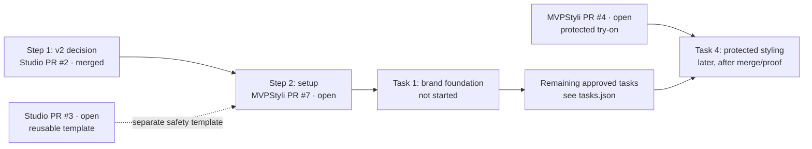

# Stylit — decision steps and associated PRs

> Snapshot: 2026-11-12. **PR states below are snapshots, not live feeds.** When a new chat asks "what next?", first read the canonical [v2 vision](exec.md), [decisions](decision.md), [task plan](tasks.json) and current GitHub PR statuses. Only a new owner-approved Studio release determines which implementation task starts; the dispatcher does not choose.

## Step 1 — Product direction and interaction model

**Questions:** Should Shop become one image-first Stylist screen? Which experiences and existing records are reused? What is in/out of scope?

**Decision:** Approved vision **v2**, with one screen, four chips, no new application data tables. Full detail stays in [exec.md](exec.md) and [decision.md](decision.md); this board only indexes approvals.

**PRs:**
- [Studio #2 — plan Stylit AI agent](https://github.com/killbill2792/studio/pull/2) — merged 2026-11-10; authorizes planning/code start under its gates, **not** live activation.

## Step 2 — Repository rules and safe execution

**Questions:** How do we prevent wrong repo, stale vision, missed landing failures and autonomous next-task selection? Which checks run before code begins?

**Decision:** Chat releases new tasks; GitHub/dispatcher handle execution monitoring. Keep product coding behind explicit approvals. Treat merge and integration proof separately.

**PRs:**
- [Studio #3 — reusable repo marker and landing checks](https://github.com/killbill2792/studio/pull/3) — **open** on snapshot; optional template for future products.
- [MVPStyli #7 — Stylit rules and CI bootstrap](https://github.com/killbill2792/MVPStyli/pull/7) — **open** on snapshot. Bundles one-time infrastructure preparation for planned 0a/0b; it is not a feature coding task. **Does not install an active dispatcher runtime.**
- Independent dispatcher installer: [AI CAFE install-sync.mjs](https://github.com/killbill2792/aicafe/blob/main/scripts/dev-dispatcher/install-sync.mjs). Runtime connection/credentials and chat-owned release enforcement are still pending.

## Step 3 — Existing protected try-on work

**Questions:** Has the try-on, user-image ownership, history and associated migration work landed? Is integration proven?

**PRs:**
- [MVPStyli #4 — existing protected work](https://github.com/killbill2792/MVPStyli/pull/4) — **open** on snapshot.
- Task 4 protected presentation reconciliation and later try-on-dependent tasks must respect the [task plan](tasks.json)'s PR #4 merge/proof/migration gates.

## Step 4 — Chat chooses the next PR

**Questions for a new Studio chat:** Which approved tasks are now eligible? Which PRs merged or failed? What decisions remain unanswered? Which *one* next task should be released, and which existing coding chat or new chat should own it?

**Decision:** **Not selected yet.** On return, Studio Exec/Product/Dev (and Marketing when relevant) reads live PRs and proposes the next step, then records owner approval/release. There is no dispatcher-initiated next-task launch. Approved merge order remains `0a → 0b → 1 → 2 → 3 → 4 → 5 → 7 → 6 → 8 → 9 → 10`; PR #7 consolidates one-time safety setup for 0a/0b, but must merge and be verified before Task 1 starts.

## All PRs and key dependencies

**Source of truth for task-to-task edges:** [tasks.json](tasks.json) (the diagram highlights significant PR-level gates, not every task edge).

| PR | Purpose | Depends on | Current snapshot |
| --- | --- | --- | --- |
| Studio [#2](https://github.com/killbill2792/studio/pull/2) | Product/architecture decisions | Owner merge | Merged |
| Studio [#3](https://github.com/killbill2792/studio/pull/3) | Copyable CI safety templates | Independent | Open |
| MVPStyli [#7](https://github.com/killbill2792/MVPStyli/pull/7) | Rules and quick checks | Approved v2 planning | Open |
| MVPStyli [#4](https://github.com/killbill2792/MVPStyli/pull/4) | Protected try-on work | Its original approvals and own CI | Open |
| Next implementation PR | Studio chat must explicitly choose/release | Setup and task-plan dependencies | **Not started** |

**Reminder:** merging a PR is not proof of integration. Post-merge tests and applied migrations require independent evidence, and owner-only production changes remain owner-held.
