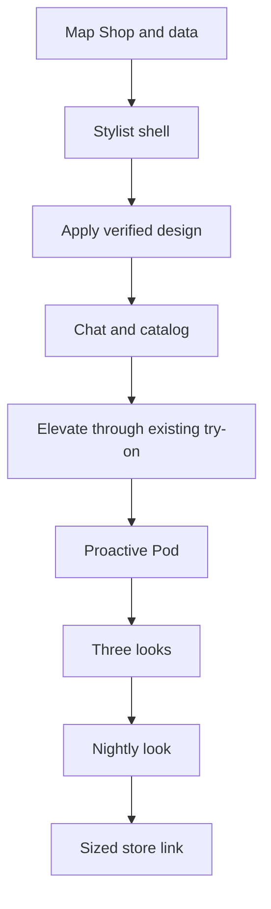

# Decision: Stylit Agent

## Current vision
[exec.md — v1](https://github.com/killbill2792/studio/blob/main/studio/ideas/stylit-agent/exec.md) is the only current vision. This decision file records gates and constraints, not the vision text.

## Handoff
- Goal: Follow current exec.md. Do not restate vision here.
- Status: proposed; no app code changed.
- Owner decision: Workflow 1 (Stylist screen) **Approved by owner 2026-11-10, 10:18 AM PT**; Workflow 2 (Style my closet + three looks) **Approved by owner 2026-11-10, 10:22 AM PT**; Workflow 3 (tomorrow's look) **Approved by owner 2026-11-10, 10:36 AM PT**; Workflow 4 (find and buy) **Approved by owner 2026-11-10, 10:40 AM PT**; Workflow 5 (Elevate / Try On) **Approved by owner 2026-11-10, 10:51 AM PT**. Other workflows pending owner review. Vision stays v1. **Merge of this studio PR is the separate feature-start approval**; do not merge automatically.
- Why: Owner's direction is recorded only in current exec.md.
- Merge order: tasks 0a, 0b, 1–9; follow AGENTS.md and prove each parent before merging a child.
- Code repo: killbill2792/MVPStyli only. This studio PR holds plans only.

## Workflow 2 locked requirements
- Entry: Stylist **Style my closet**; exactly 3–4 clothing photos; require `profiles.body_image_url` full-body image first; generate immediately, without repurposing More Looks.
- Server-side **OpenAI GPT-4.1 mini on Vercel** plans Closet (uploaded pieces only), Elevated (uploaded base plus 1–2 catalog pieces), and Makeover (new style). An optional question is asked during generation; save answers to the style profile and use timely answers for this run, late answers for the next; skip never blocks generation.
- A separate server compositor makes one garment image per outfit, then starts three **parallel** PR #4-gated Nano Banana image jobs. Do not edit PR #4. Rough estimate **20–30 s for images**, plus uploads/planning/composition; **1 LLM call and 3 image generations per run**, costs unverified and not yet authorized.
- New private `closet_items` table with user_id, per-user private storage image_path, type, color, created_at; RLS/storage isolation. Never mix with `garments`. PR #4 server-only `try_on_history` records each successful image.
- Three swipe cards under main image; tap to promote; each Send to Pod suggests Global. Partial failure shows the other looks and Retry on the failed card.
- Task 7 requires PR #4 merged and `STYLIT_TRYON_TEST_ENABLED` until go-live approval. Tasks 2/5 cannot edit `App.js` before PR #4 merge; otherwise avoid it and all PR #4 files.

## Workflow 3 locked requirements
- Hourly **Supabase pg_cron** selects opted-in users whose saved IANA time zone is at 21:00 local and who were active in the last 7 days; dispatch **one job per user** to the app's Vercel backend. Respect its **30 s limit**; never one long batch. The device saves `profiles.timezone` and `profiles.city` at sign-in.
- Weather is **Open-Meteo free forecast for testing only**; commercial use/provider choice needs owner's go-live OK. Events come from Stylist disclosures and opt-in **expo-calendar** titles/times synced privately at the last app open.
- Reuse Workflow 2's **server LLM picker** for one look and its multi-piece image composer, then **only PR #4 Nano Banana path**. One retry, then skip night. No Dave/external bots.
- Private `tomorrow_looks` with unique `(user_id, local_date)`, look items, image path, weather, event and status; per-device Expo tokens; in-app notification and **server-only** `try_on_history`. RLS/ownership and idempotency required.
- Text-only Expo push: **“Tomorrow's look is ready.”** iOS image-in-notification needs a Notification Service Extension and owner go-live approval.
- Opening push/in-app row shows the look as Stylist main photo, short reason, Wear it / Show me more / Send to Pod (Global suggested). No closet -> invite three photos; no body photo -> request one; denied push -> keep look in-app; generation error -> retry once then skip.
- **Estimated $0.04–$0.06 per eligible active user/night**, unverified. Task 8 requires **MVPStyli PR #4 merged, PR #4 history SQL applied, and task 7 closet_items/composition proven**. Entire workflow stays dark/mock until final go-live approval.

## Workflow 4 locked requirements
- **Approved by owner 2026-11-10, 10:40 AM PT.** Proactive **“I found this”** runs only after a new shoppable look (Elevate, Elevated/Makeover, tomorrow), never at app open or twice for the same look. Also respond to user shopping requests. Button **Buy**; Workflow 1's ten-card sheet remains browse path.
- Catalog first: `lib/garmentUtils.js` -> `GET /api/garments?active_only=true` (linked `garments` + `garment_sizes`); if no match, **one** `lib/productSearch.ts` -> `/api/searchwebproducts` (SerpAPI) query, subject to per-user search cap. Rank by real style fingerprint, color season and outfit; no invented score, new shopping API, fake items or unapproved live search.
- **No size displayed on any look or catalog card before interest.** Always show valid photo/brand/price. Stylist over-outfit card explains the choice and shows Try On and Buy. Only after Try On, **“I like this”** or Buy, run `recommendSizeAndFit` with measurements and `garment_sizes` or brand-size chart. Otherwise labeled `top_size`/`bottom_size` **“your profile size”**, or **“size not confirmed”** with Fit Profile prompt. No OCR dependency.
- Buy V1 uses `Linking.openURL` only for validated `product_link` / `productUrl`; size stays visible in Stylit with “pick Size M on the store page” only if known. Never claim store-side selection. No charge, checkout, affiliate links, payments or order tables.
- New RLS-protected `buy_intents` (`user_id`, title, brand, price, image, store_url, source `garments|web`, size_shown, size_source `fitcheck|profile|unconfirmed`, opened_at), dedup repeated taps; optional `user_events`. Never use missing `products` table.
- Known out of stock or broken link -> no Buy, mark unavailable; search down/no key -> real catalog or empty + Retry; missing fit/`INSUFFICIENT_DATA` -> profile/unconfirmed; failed Try On -> retain card and Retry Try On only.
- Rough waits **1–3 s catalog**, **2–5 s web**; catalog **$0 search-provider cost**, SerpAPI **~$0.01–$0.02/search (unverified)**. Task 9 must wait for PR #4 merged for Try On, gated by `STYLIT_TRYON_TEST_ENABLED`. No keys, live search, or affiliate use until owner go-live approval.

## Workflow 5 locked requirements
- **Approved by owner 2026-11-10, 10:51 AM PT.** Show Elevate row only if a closet/previous/tomorrow look is already the main photo. Never on an empty screen; no body-photo collection branch. Use the displayed look as `human_img`. Short row follows owner's mockup/Figma count.
- Source active, image-backed and mappable garments **only** from `lib/garmentUtils.js` -> `GET /api/garments?active_only=true` (`garments`); rank with `lib/styleEngine.ts`, color season and the current look; **no SerpAPI**. Each card shows image, brand, price, Try On; **no size before Try On**. After the tap, existing `lib/fitLogic.js` Fit Check or labeled profile size / “size not confirmed” per WF4.
- User must be signed in. Copy remote garment image into the user's owned uploads with `lib/upload.ts` `uploadRemoteImage` before try-on; PR #4 rejects external URLs and has no allowed catalog URLs. Use existing `App.js` category map to `upper_body/lower_body/dresses`; unmappable -> no call.
- Use PR #4 **only**: `lib/tryonClient.ts` -> `lib/tryon.ts` `startTryOn/pollTryOn`, `POST /api/tryon {human_img,garm_img,category}`. Synchronous generation returns owner-bound `jobId` completion receipt; `GET /api/tryon/<jobId>` **verifies only**, with **15-minute** expiry. No new image client and no PR #4 file edits.
- Save through `lib/tryOnHistory.ts` -> `POST /api/tryon/history`, with **server-only `try_on_history` writes**. Swap to successful image first; if history save fails, **keep photo, warn**. **No new `user_events` row** for WF5; retain existing approved style tracking.
- **Estimated 10–20 s**, old photo + progress line + optional style question; save answers like WF2 without waiting. Not signed in -> sign in; gate off/`TEST_NOT_CONFIGURED` -> “not available yet”, never fake image; copy/ownership error -> another item; `FORBIDDEN/TIMEOUT/RATE_LIMIT/PROVIDER_FAILURE/STORAGE_FAILURE` -> keep old image and Retry only that item.
- **Estimated $0.03–$0.04/try-on**, unverified. Server-enforced per-user daily generation cap required before go-live. Task 5 depends on **MVPStyli PR #4 merged** and **both SQL files applied**: `20261031_server_only_try_on_history_writes.sql` and `20261105_current_user_image_ownership_rpc.sql`; `STYLIT_TRYON_TEST_ENABLED` plus TEST pins, and owner go-live gate.

## Do not break
- No vision drift: v1 is only in current exec.md. On owner-approved changes, archive the old text under archive/ marked SUPERSEDED and never read archive/ in coding chats. Every coding PR must state its vision version; CI rejects mismatch with the current exec.md version. MVPStyli AGENTS.md must contain rules and a link only, no copied vision.
- Lakshmi7580's open [MVPStyli PR #4](https://github.com/killbill2792/MVPStyli/pull/4): gated Nano Banana try-on; **only** its code path may call the image model. Reuse it; never edit its files. If it merges first, base subsequent app branches on top; otherwise wait for it or avoid all changed files, including shared `App.js` and `screens/StyleVaultScreen.js`.
- Preserve server-only `try_on_history` writes, ownership checks on deletes, storage/image ownership, missing-`products` handling, and unapplied `scripts/migrations/20261031_server_only_try_on_history_writes.sql`. Do not assume SQL has run or bypass its guards. No direct client history writes.
- Preserve Pods (friends/twins/global, timing, voting, recaps, guest votes and invites), profiles/StyleVault, wardrobe, Fit Profile, Fit Check and other navigation.
- Task 1 must inventory Shop's `fetchGarmentsAsProducts` -> `/api/garments` -> `garments` and `garment_sizes` dependencies before removing Shop UI. Do not delete product detail or shared garment code.
- No production, App Store, paid API, live checkout, secret, or scheduled push enablement without final owner go-live OK. Use mocks/test fences while building.

## Exec view
Refer only to current [exec.md](https://github.com/killbill2792/studio/blob/main/studio/ideas/stylit-agent/exec.md).

## Product view
Refer to product.md for implementation details, not a second vision.

## Dev view
Use small isolated adapters and CI checks. First add rules-only MVPStyli AGENTS.md and enforce a PR-body current-version check.

## Marketing view
Wait until merged and proven; Claude Medium writes and Muse posts.

## Open questions
- Owner mockup and Thanmayi's Nov 4 Figma wireframes (Trello tz4sewiZ) could not be opened; do not guess colors or layouts. Obtain them before design task.
- Verify PR #4 merge and SQL deployment status before any try-on feature.
- Workflow 3 chose on-device expo-calendar opt-in, IANA time zone and city, and text-only push. Validate provider commercial rights, permissions, Vercel timing and actual costs before go-live; image-in-notification is a separate owner decision.
- Studio KNOWLEDGE.md leaves D7, D8 and D9 undecided; do not invent rulings.

## Lessons
Coding chats append what broke, what later tasks need to know and the fix.
