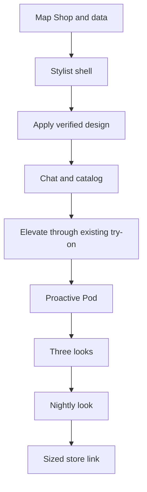

# Decision: Stylit Agent

## Handoff
- Goal: One visual Stylist replaces Shop, using existing app services.
- Status: proposed; no app code changed.
- Owner decision: Vision and workflow brief accepted for proposal; **merge of this studio PR is the separate feature-start approval**. Do not merge automatically.
- Why: Style is identity; the agent acts early, then users validate looks with Pods.
- Merge order: tasks 1–9, one app PR each; follow AGENTS.md and prove each parent before merging a child.
- Code repo: killbill2792/MVPStyli only. This studio PR holds plans only.

## Do not break
- Lakshmi7580's open [MVPStyli PR #4](https://github.com/killbill2792/MVPStyli/pull/4): gated Nano Banana try-on; **only** its code path may call the image model. Reuse it; never edit its files. If it merges first, base subsequent app branches on top; otherwise wait for it or avoid all changed files, including shared `App.js` and `screens/StyleVaultScreen.js`.
- Preserve server-only `try_on_history` writes, ownership checks on deletes, storage/image ownership, missing-`products` handling, and unapplied `scripts/migrations/20261031_server_only_try_on_history_writes.sql`. Do not assume SQL has run or bypass its guards. No direct client history writes.
- Preserve Pods (friends/twins/global, timing, voting, recaps, guest votes and invites), profiles/StyleVault, wardrobe, Fit Profile, Fit Check and other navigation.
- Task 1 must inventory Shop's `fetchGarmentsAsProducts` -> `/api/garments` -> `garments` and `garment_sizes` dependencies before removing Shop UI. Do not delete product detail or shared garment code.
- No production, App Store, paid API, live checkout, secret, or scheduled push enablement without final owner go-live OK. Use mocks/test fences while building.

## Exec view
One identity-first Stylist screen with visual transformations and proactive advice.

## Product view
Outfit image, short advice, item row, quick chips, bottom chat, catalog sheet, Pods, three looks, tomorrow's look and store-link shopping.

## Dev view
Reuse live app routes/services; introduce small isolated adapters and CI checks, not a second try-on provider. Merge in order with proven parents.

## Marketing view
Wait until merged and proven; Claude Medium writes and Muse posts.

## Open questions
- Owner mockup and Thanmayi's Nov 4 Figma wireframes (Trello tz4sewiZ) could not be opened; do not guess colors or layouts. Obtain them before design task.
- Verify PR #4 merge and SQL deployment status before any try-on feature.
- Nightly calendar source, permissions, time zone, weather provider, image push support and real provider costs need test-environment validation.
- Studio KNOWLEDGE.md leaves D7, D8 and D9 undecided; do not invent rulings.

## Lessons
Coding chats append what broke, what later tasks need to know and the fix.
