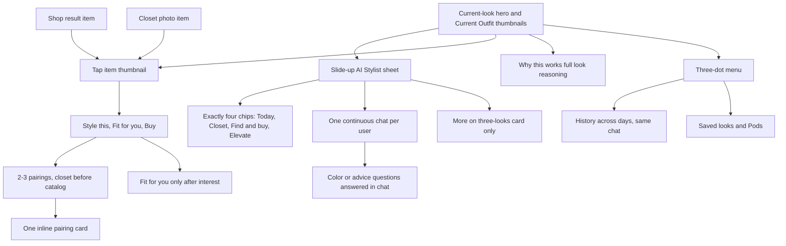
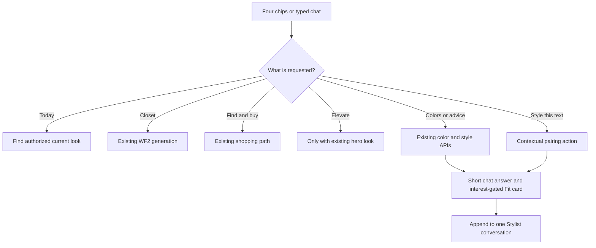
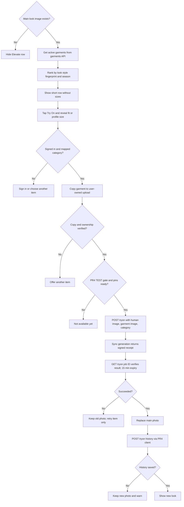
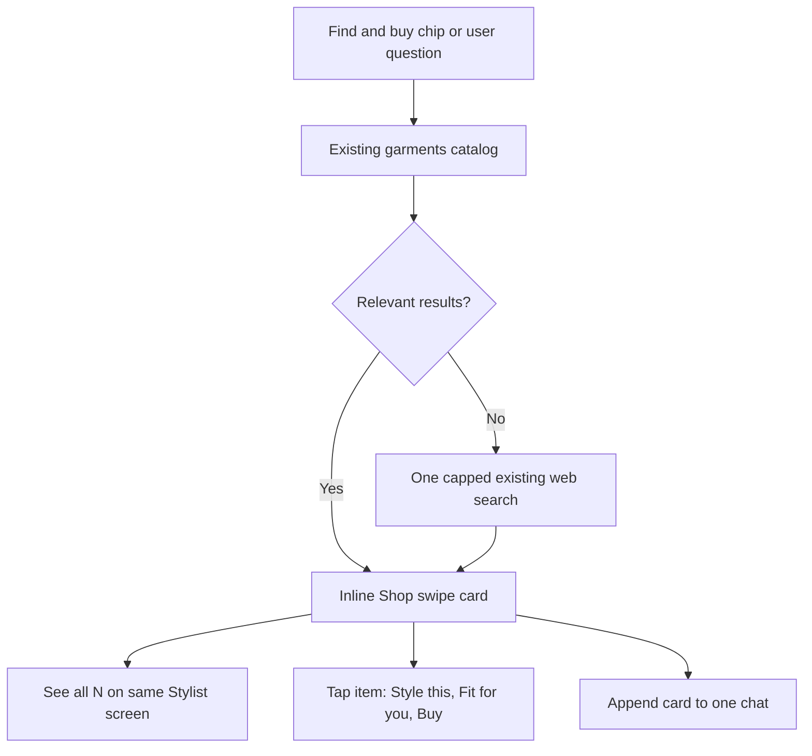
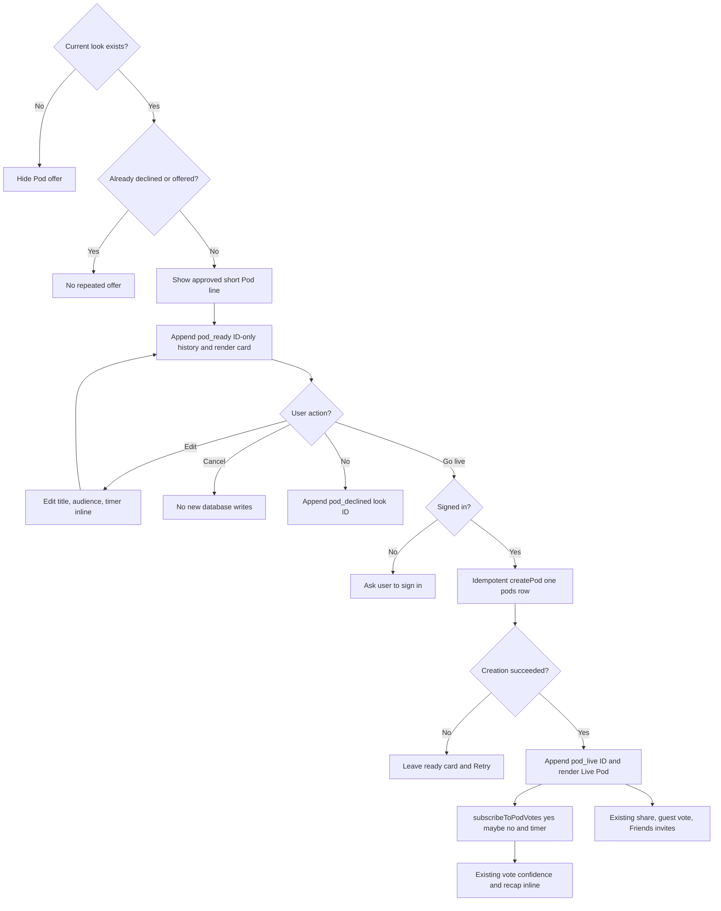
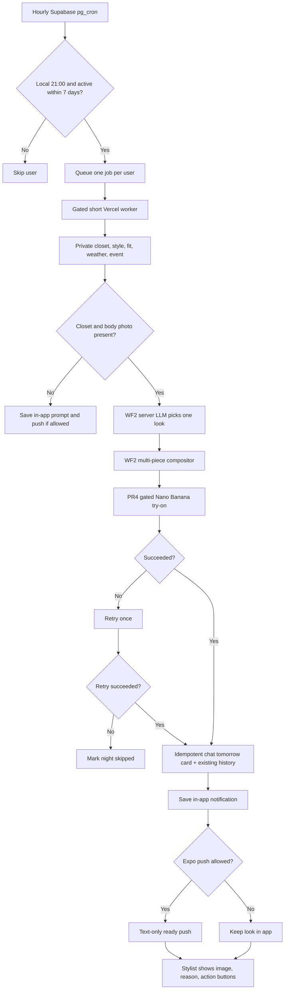

# Dev: Stylit Agent

Status: proposed; all code later in killbill2792/MVPStyli

## Current vision
Read [exec.md — v2](https://github.com/killbill2792/studio/blob/main/studio/ideas/stylit-agent/exec.md) for the only current vision. This file is implementation design, not a second vision.

## Architecture
The app uses `App.js` route state and `components/BottomBar.js`. `shop` shows an inline grid; `chat` shows legacy `screens/ChatScreen.js`; `account` renders `screens/StyleVaultScreen.js`; `userprofile` renders `screens/UserProfileScreen.js`. Keep old `tryon`, `product`, `podshome`, `createpod`, `podlive`, `podguest`, and `podrecap` routes functional for existing entry points. **New Stylist flows use in-screen overlays/full-screen card expansion; the Live Pod can expand within Stylist without a separate primary screen.** Preserve Explore and StyleCraft. Spaces are out of scope. `screens/AccountScreen.js` is not the active account route.

Current Shop: `App.js` calls `fetchGarmentsAsProducts` (`lib/garmentUtils.js`) for `GET /api/garments?active_only=true`; `api/garments/index.ts` reads `garments` and optional `garment_sizes`. The Shop grid opens `screens/ProductScreen.js`; Fit Check uses its size mapping and `lib/fitLogic.js`. `lib/productApi.js` contains older direct `products` writes; do not assume that table exists.

Reuse, do not rebuild: `screens/ChatScreen.js`, `lib/productSearch.ts` and `api/searchwebproducts/index.ts` (SerpAPI); `screens/PodsScreen.js`, `PodsHome.js`, `PodLive.js`, `PodGuest.js`, `PodRecap.js`, `lib/pods.ts` (friends/twins/global, timer, votes, guest votes and invites); `lib/colorAnalysis.ts` and `api/analyze-skin-tone/index.ts` (face/color season); `StyleVaultScreen.js` and profiles (manual Fit Profile); `lib/styleEngine.ts` (try-on/vote event fingerprint and style twins); `lib/fitLogic.js` and `components/AskAISheet.js` (rule-based Fit Check). PR #4 owns the only Nano Banana model call path.

```mermaid
flowchart TD
  UI[Stylist hero, outfit panel, slide-up sheet and 4 chips] --> app[App route and existing context]
  app --> style[Style engine and profiles]
  app --> catalog[Inline Shop swipe card and existing search APIs]
  app --> pod[Existing Pods data and full-screen card]
  app --> tryon[PR4 gated try-on server]
  tryon --> imageHistory[Owned storage and try_on_history]
  cron[Hourly Supabase pg_cron - gated] --> worker[One Vercel job per eligible user]
  worker --> tryon
  worker --> push[Text-only Expo push - gated]
```

## Owner-approved full-app design kit and motion standard — November 10, 2026
**Visual kit approved 12:23 PM PT; motion correction at 12:24 PM PT supersedes “animate every button” and the generic press-bounce default; build reordering approved 12:29 PM PT.** These are **implementation and design standards**, not a new vision: the only current vision remains [exec.md — v2](https://github.com/killbill2792/studio/blob/main/studio/ideas/stylit-agent/exec.md). Source: owner's supplied specification of two Figma PDFs, white-first photo adjustment. Confirm pixel details with original assets at visual sign-off.

### Shared visual tokens (Task 1 first)
| Token | Approved value / usage |
| --- | --- |
| Typography | **Inter**, fallback **SF Pro Display** / system sans; **sentence case**. Heading **20/24 Bold**, title **14/18 Bold**, body **14/20 Regular**, chip/button **12/16 Semibold**, bottom-nav label **12/14 Medium**. Allow dynamic type and accessible wrapping. |
| Backgrounds | **#FFFFFF** on all photo/outfit surfaces and screens; **#FAF8FF** only on non-photo screens. **Never tint behind or around outfit photos**; actual garment colors must remain neutral. Lavender belongs on controls only. |
| Cards & nav | Surface **#FFFFFF**, **1 px #EFE8FF** stroke. Photo radius **26**, card radius **27**. |
| Brand actions | Primary **#6929FE** for links, primary buttons and active tab; main CTA only may use **#862FFF → #6929FE** gradient. Other buttons stay solid/neutral. |
| Soft selection | Lavender chip/countdown/selected nav surface **#F2EDFD**; selected stronger **#E9DFFF**. |
| Text & vote | Primary **#08082F**, secondary **#7650D9**, muted **#8A8AA3**; negative/No **#F05267**. Retain legible contrast, never convey votes by color alone. |
| Shapes | Buttons **24**, chips/tabs **18**, bottom navigation **32**, avatars/bell **50%**. |
| Bottom navigation | **Floating 366 × 64 pill** on **393 × 852 iPhone portrait** reference frame, **five existing destinations Home / Explore / Try On / Pods / Profile**. Icons **20–22**; active state **#E9DFFF** pill + **#6929FE** icon/label. **These five app-nav tabs are distinct from exactly four AI Stylist sheet chips (Today's look / Style my closet / Find & buy / Elevate).** Home hosts the new Stylist route; do not create a sixth screen. Safe-area and smaller-screen widths adapt without clipping. |
| Website | Later **separate website redesign task**, not part of MVPStyli Task 1 or this studio PR's app implementation. Reuse published brand tokens later only after a separately approved website task. |

**All existing screens** should ultimately use these tokens: Home/Stylist and Chat; Explore, StyleCraft, PodsHome, PodsScreen, PodLive, PodGuest, PodRecap, Inbox; Auth, Account/Profile/UserProfile/StyleVault; Product, TryOnResult, garment admin and photo utility screens. Apply through shared `lib/designSystem.js`, new brand tokens and reusable components first, then migrate screen-local *presentation only*. **Do not disturb data, navigation contracts, product searches, votes, try-on model/history, ownership or Fit Check.** Task 1's explicit allowed-files list may edit only safe existing files; PR #4-owned `App.js`, `screens/StyleVaultScreen.js`, `lib/productApi.js`, `lib/tryon.ts`, `lib/upload.ts` and every other file in PR #4 are **forbidden**. UI in protected files takes the shared theme indirectly where already consumed. **Task 4 is the explicit post-PR4-merge presentation reconciliation:** its `allowed_files` include **`App.js` (UI/navigation shell only)**, **`screens/StyleVaultScreen.js` (UI only)**, and `tests/stylist/protectedBrandReconciliation.test.cjs`. Task 4 must wait for PR #4 to merge and be proven on the default branch, rebase onto it, then apply shared styling only. PR #4's try-on, image ownership, model client, history, API, product and migration files remain out of scope. **Task 1's allowlist remains unchanged and excludes all PR #4 paths.** Track coverage with a screen matrix and explain partial coverage at handoff rather than claiming protected screens are done.

### Motion policy: unique, meaningful actions only
Use **react-native-reanimated** and **expo-haptics** with reusable *action-specific* Lottie/Reanimated components. **No generic shared press scale, bounce or confetti animation.** Every approved animated action below has its **own visual language and reason**, and each discrete motion cycle/transition takes **less than one second**, **never blocks taps/navigation**, respects iOS **Reduce Motion**, and degrades to static state changes when motion is off. Haptic only for intentional actions and when permitted; no sound. Real data drives counters, progress and streaks; **never invent percentages or success**. Long try-on generation may repeat sub-second scan/shimmer cycles while the photo remains visible, not hold a single animation longer than 1 s.

| Meaningful event / action | Unique animation (approx. transition time) | Why this action has this motion |
| --- | --- | --- |
| **Double-tap hero to like a look** | **Purple–pink gradient heart** blooms at tap point, makes a central large heart with small hearts/sparkles, then rises/dissolves (**650 ms**); only after successful like/save. | A recognizable, signature fashion-love gesture; visually distinct from all other actions. |
| **Bookmark / save look** | Outline bookmark **draws inward and inks purple**, with a tiny corner star glint (**260 ms**); revert on save failure. No heart explosion. | A quiet filing/keeping action, not the emotional double-tap. |
| **Yes vote** | **Violet confetti and sparkle burst emitted from Yes button**, actual vote bar fills with a spring, outfit flashes a thin violet edge glow (**560 ms**). | Positive collective validation; joy localized to the positive choice. |
| **No vote** | Outfit card performs a **gentle horizontal shake**, thumb icon **flips to down**, no confetti (**350 ms**). | A gentle, unambiguous rejection without celebration. |
| **Maybe vote** | **Asymmetric wobble** of Maybe choice with one floating **🤔** bubble (**480 ms**). | Deliberate uncertainty, visibly unlike Yes/No. |
| **Try On generating** | Keep **existing person's photo** fully visible, continuous soft **shimmer sweep** plus thin **scanning glow** descending the image; a non-numeric progress ring and rotating copy **“Pulling the fit…” / “Matching colors…” / “Almost there…”**; each sweep **~850 ms**, repeat while pending and permit other taps. | Communicates ongoing visual transformation without a blank spinner or false percentage. |
| **Try On success** | New outfit image **unwraps top-to-bottom** under a moving sparkle seam, with cross-fade and **“✨ Looking good”** toast; success haptic (**700 ms**). | Reveals actual transformed clothing, rather than generic celebration. |
| **Pod-ready card created after Send to Pod** | A **ballot card unfolds vertically** around the default photo/title/Global/15-minute controls (**320 ms**); no votes generated. | Makes consent/preparation tangible without implying Go live happened. |
| **Go live on a Pod** | Countdown ring **pulses once** and a **short full-screen confetti rain** ends within **800 ms**, with success haptic only after real `createPod` success. | A distinct public-launch milestone; not the same localized Yes-vote burst. |
| **Swipe one of three looks** | On release the card **tilts and flies off with spring physics** to its chosen side and a **heart or X stamp appears under the drag**, settling within **~650 ms**. | Gestural fashion exploration with spatial direction; no silent auto-save. |
| **Tomorrow's look ready** | Small **star/sparkle halo expands behind the existing notification card icon** (**420 ms**) when a real look is ready; no animation for an unsent or failed generation. | Anticipation of the next day's outfit without a full-screen interruption. |
| **Real streak milestone** | A **single flame lick rises and flickers** beside the verified streak indicator (**540 ms**); never show streak UI or celebration without real existing streak data. | Recognizes consistency with a distinct upward flame, not generic stars. |
| **Assistant's new short reply** | Text appears as a **left-to-right ink reveal** in its chat bubble (**170 ms**), not a generic button bounce or all-card slide. | Signals conversational response, not a reward. |
| **Style this pairings completed** | Exactly 2–3 product tiles **slot into a shared outfit rail** in a tiny stagger (**450 ms total**), only after genuine items are returned. | Shows items being combined into an outfit, unlike Try On image generation. |
| **New Shop results arrive** | The swipeable result **photo rail fans gently from the first real product tile** (**300 ms**) only on result receipt. | Introduces discovery content without fake product pop-ins. |

**Intentionally NO custom animation** (standard iOS/native feedback only): back, close, cancel, menu/three-dot, History/Saved looks menu selections, editing title/audience/timer, settings, profile edits, text field focus/typing, keyboard, normal scroll, plain links and **Buy** handoff to merchant, utility toggles, **all five bottom-nav tabs**, the four Stylist chips themselves, ordinary card expansion/collapse and non-meaningful loading/Retry controls. **The floating bottom-nav active pill changes state without custom slide**, explicitly overruling the earlier proposed tab-pill slide. Avoid universal hover/press scale and unconditional haptic; not every tap deserves a reward. **Pod No** (rejecting an offer) is a utility decline and does not use the **No vote** animation.

**Reduce Motion / performance:** In reduced-motion mode, replace each effect with an immediate state change, static icon and readable toast; keep haptics optional/off as configured. Use native driver/worklet scheduling as appropriate, cancel animations on unmount, throttle repeated taps and unsubscribe vote listeners. Run on 393 × 852 reference and at narrow/dynamic-font sizes; avoid photo tinting, opaque overlays on clothing, flashing, confetti over unreadable text, and overlays lasting >=1 s.

**Three optional original delights for owner consideration, not approved for implementation:** (1) on user-initiated **Why this works**, a fine violet **seam-trace** briefly outlines the specific clothing feature being explained (~550 ms), grounded in real item geometry; (2) after actual Fit Profile completion, a **measuring-tape curl** retracts into the profile badge (~500 ms), distinct from try-on and voting; (3) when restoring a past saved look from History, a **single photo contact-sheet tile lifts into the hero** (~480 ms), not a tab/menu animation. Do **not** build any of these until separately approved and safety/accessibility-checked.

## Final interaction model — owner-approved 2026-11-10, 12:13 PM PT
This **supersedes earlier chip sets, standalone Mix & Match / Color Analysis / Style Advice workflows and any proposed new tables**. See [exec.md — v2](https://github.com/killbill2792/studio/blob/main/studio/ideas/stylit-agent/exec.md) for the only current vision.

- **Base screen:** large hero with currently worn look; floating Current Outfit with *real* item thumbnails, brands and remove ×; bookmark/share and Why this works. AI Stylist sheet slides up/down and contains latest short messages, interactive cards and **exactly four chips: Today's look, Style my closet, Find & buy, Elevate**. Slim chat expands only during typing. Today's look retrieves the current authorized saved/scheduled look or prompts for closet setup; it does not force unapproved generation. Elevate chip stays visible but is disabled without a current look; Elevate row appears only when one exists.
- **One continuous thread:** one `chat_conversations.kind='stylist'` row per user, plus existing `chat_messages` (no chat picker). Default keeps full history hidden. Three-dot menu has **only History and Saved looks & Pods**. History queries that same conversation by date and `card_type`, groups with day dividers and scrollback across days. Tapping an old Look/Shop/Pod/Tomorrow/Try-on card expands it full screen *within Stylist* and restores the authorized look to the hero. No new screens or Spaces.
- **Inline cards:** Look, Elevate, Pod ready, Live Pod, Shop, Closet three looks, Tomorrow, Try-on and contextual pairing card. Shop card is a swipe row with photo, brand, price, Try On, Buy and **See all N** in the same sheet. Three-looks card has its own **More** button that reuses WF2 picker/compositor and PR #4 with all original gates. **No More Looks chip**.
- **Style this, not a workflow/chip:** Any Current Outfit thumbnail, closet item or Shop item opens a three-action mini-menu **Style this / Fit for you / Buy** (unavailable action disabled when no valid item/link). Typing “what goes with my black jeans?” dispatches the same Style this intent. Read owned closet image references from current conversation/Storage first, fill remaining choices with `lib/garmentUtils.js` -> `/api/garments?active_only=true`; rank 2–3 realistic pairings against outfit and style profile. Return **one inline pairing card** with 2–3 suggestions and Try On only when hero look exists; Buy (verified link only) and Send to Pod (requires a selected current/generated look). No size/fit before interest.
- **Chat color and advice:** “what colors suit me?” or style advice typed in chat uses existing `POST /api/analyze-skin-tone` with consent and `lib/colorAnalysis.ts` `saveColorProfile` for missing profile data, otherwise `getStyleProfile`, color profile and Fit Profile. Reply in the **same chat**. On a selected/interested item, the **Fit for you** card combines `lib/fitLogic.js` `recommendSizeAndFit` size and fit note (or labeled profile size/size not confirmed), `lib/colorScoring.js` `computeColorScore` skin-tone color swatches/verdict great/good/ok/risky and a supported `lib/styleSuitability.js` face/body line. A hero **Why this works** action displays the supported full look summary. Do not show Fit for you or invented scores before item interest.
- **Only existing tables:** `chat_conversations` and `chat_messages` store all user-visible thread lines/cards, references and durable event markers (e.g. `pod_declined`, `buy_intent`, `tomorrow`) through additive `kind`, `card_type`, `payload` columns/checks/indexes. `chat_messages.type='user'|'ai'` stays backwards compatible. No new application tables; **no `closet_items`, `tomorrow_looks`, `buy_intents` or separate history/saved-look table**. For canonical objects use existing `pods`, `try_on_history`, `saved_fits`, `notifications`, `profiles`, `user_style_profile`, `user_events`. Store closet photos in **per-user protected paths in existing Supabase Storage**, referenced by storage object keys + minimal type/color metadata on user-owned `chat_messages` cards; **not** `garments`. For ephemeral web products, store only necessary validated source identifier/link and minimal display metadata on the Shop card, not a new product table.
- **One-user invariant and safety:** enforce partial unique index for `kind='stylist'` on existing `chat_conversations.user_id`, transactional get-or-create, owner-only RLS for both chat tables and Storage objects. Remove permissive public policies in `scripts/ADD_CHAT_HISTORY.sql` via additive migration; do not edit old setup or let legacy `kind='shop'` chat leak. Order by `created_at,id`; past messages never rewritten/deleted for state changes. Prefer ID-only refs to canonical rows and minimal typed JSON payload for card-only data. Dedupe `(conversation_id,card_type,look_id/action_key/local_date)` using constraints/guarded operations on **existing** chat_messages; no new tables.
- **Words in the UI:** never expose “workflow” or workflow numbers to users. Internal plan headings may keep numbers. Visible labels are the four chips, the three-item contextual menu, **More** on three-looks, Fit for you, Why this works, Try On, Buy, Send to Pod.



## Workflows
All wait ranges are rough estimates, not measured SLAs. Costs are per use: provider rates are not verified; no paid/live use is authorized by this plan.

### 1. Stylist chat turn — Workflow 1
**Approved by owner 2026-11-10, 10:18 AM PT; final interaction update 12:13 PM PT.**
- Trigger/screen: One slim chat bar in the slide-up AI Stylist sheet, plus exactly four chips: **Today's look, Style my closet, Find & buy, Elevate**. Older history hidden by default; each user has one continuous conversation. No “workflow” labels in the UI.
- Calls: Route typed product questions to existing catalog/search, “what goes with my black jeans?” to **Style this** action, “what colors suit me?” to existing `POST /api/analyze-skin-tone` plus `saveColorProfile` if consented, and style questions to `getStyleProfile`, color and Fit Profile. Pod and image actions call only approved paths. No separate Mix & Match, Color Analysis or Style Advice chip/workflow.
- Saved: Append short text and typed inline card references to one owner-scoped `chat_conversations(kind=stylist)`/`chat_messages`; existing Shop chat kind stays separate. For color analysis, save only through existing color-profile path. Use current card state and reference IDs, no new table.
- Wait/screen: Estimated **0.5–2 s** for local advice, **2–5 s** for profile/search, **5–15 s** for optional existing image-based color analysis; show short thinking line, no long chat wall or new screen.
- Failure: No profile/consent -> ask/setup or give clearly general advice; network/key unavailable -> retry without invented color/profile score. Do not show item Fit for you before interest.
- Cost: Local rules no new model fee; existing Supabase use. Existing color analysis/search provider charges unverified; test mocks and go-live gate apply.



### 2. Elevate / Try On — Workflow 5
**Approved by owner 2026-11-10, 10:51 AM PT.**

- **Trigger/screen:** The **Elevate Your Look** row appears **only after** a closet look, earlier try-on, or tomorrow's look is already the Stylist's main image. **Never show the row on an empty screen.** The **Elevate** chip is always one of the four chips, but disabled when there is no current look; tap it to reveal the row. Tap **Try On** on a row item. The **on-screen look image is always `human_img`**; no “upload body photo” branch in this workflow (WF2 handles body-photo collection).
- **Items/calls:** Only active garments from `lib/garmentUtils.js` -> `GET /api/garments?active_only=true` -> `garments`, each with an image and a category mappable to PR #4. Rank with the current look, style fingerprint and color season using `lib/styleEngine.ts`. **No SerpAPI** for Elevate. Keep the row short, with its exact count set by the owner's mockup/Thanmayi Figma (not guessed here).
- **Fit on interest:** Row cards always show **photo, brand, price and Try On**, with **no size, color rating or face/body suitability** beforehand. Tapping a Current Outfit item also opens the same interest-gated Fit for you card. **Tapping Try On is interest**: then run existing Fit Check `lib/fitLogic.js` with available measurements and size chart, display its supported size + one fit note; otherwise show a saved profile size labeled **“your profile size”**, or **“size not confirmed”** with Fit Profile prompt (WF4). Never invent a size or size all items.
- **Prepare inputs:** Require a signed-in owner, validate the on-screen human image and garment. PR #4 rejects external garment image URLs and has an **empty catalog allowlist**: first call `lib/upload.ts` **`uploadRemoteImage`** to copy the chosen remote garment image into the signed-in user's own Storage path, verifying ownership. Reuse the category map already in `App.js`: `upper|upper_body → upper_body`, `lower|lower_body → lower_body`, `dress|dresses → dresses`. If the category is unmappable, **do not call** the API.
- **Generate:** Call PR #4's injected client (`lib/tryonClient.ts` -> `lib/tryon.ts` `startTryOn`) with `POST /api/tryon` body `{human_img, garm_img, category}`. Only `STYLIT_TRYON_TEST_ENABLED` plus **reviewed TEST identity/configuration pins** can enable this. **No new model client or edits to PR #4 files.** The create call generates synchronously and returns **`jobId` as an owner-bound completion receipt**. `pollTryOn(jobId)` -> `GET /api/tryon/<jobId>` **only verifies** that receipt/result; it does **not** start another generation. The receipt expires after **15 minutes**; do not assume it is a long-running job.
- **Save/display:** Replace the main look image with the successful result. Use PR #4's `lib/tryOnHistory.ts` `saveTryOnHistory({receipt: jobId, ...})` -> **`POST /api/tryon/history`**. Its server owns `try_on_history` inserts; **never insert from the app**. If history saving fails, **keep the new photo visible and show a warning**, without pretending history saved. **Optional `user_events` row decision: do not add one in Workflow 5**; preserve existing approved style events where applicable, and avoid a new table/write.
- **Wait/screen:** **Estimated 10–20 s**, unmeasured. Keep the previous main photo visible during generation, show a short progress line, and ask **one optional style question**. Save an answer to the user's style profile following WF2; **never wait for an answer** before generating. After success, swap the photo.
- **Failures:** Not signed in -> request sign-in; TEST gate off or `TEST_NOT_CONFIGURED` -> **“not available yet”**, with **no fake image**. Remote image copy or ownership check fails -> **“can't try on this item”** and offer another item. Unmappable category -> exclude it / no API call. `FORBIDDEN`, `TIMEOUT`, `RATE_LIMIT`, `PROVIDER_FAILURE`, `STORAGE_FAILURE` (or receipt expiry) -> keep the old photo and **Retry that item only**; no unrelated retries. History-save failure is a **warning after a successful photo**, not a failed generation.
- **Cost/limits:** **~$0.03–$0.04 per try-on (unverified estimate)**, plus storage/traffic. Add a **server-enforced per-user daily generation cap before go-live**, with a safe disabled default until the owner authorizes a limit and paid/live access. Use test mocks and no unapproved provider use.
- **Task gates:** Requires [MVPStyli PR #4](https://github.com/killbill2792/MVPStyli/pull/4) **merged and proven**, **both migrations applied and verified**: `scripts/migrations/20261031_server_only_try_on_history_writes.sql` and `scripts/migrations/20261105_current_user_image_ownership_rpc.sql`. Never edit any PR #4 file. `STYLIT_TRYON_TEST_ENABLED` and TEST pins remain mandatory; owner separately approves go-live.



### 3. Product search — inline Shop card (part of Workflow 1, not a new screen)
**Inline presentation approved 2026-11-10, 11:24 AM PT; four-chip interaction final 12:13 PM PT.**
- Trigger/screen: **Find & buy** chip or user text such as “show me a polka dot dress.” Show one inline Shop swipe row with photo, brand, price, Try On, Buy, **See all N**; no standalone Shop page.
- Calls/saved: `lib/garmentUtils.js` / `GET /api/garments?active_only=true` first; if needed one capped `lib/productSearch.ts` -> `POST /api/searchwebproducts` fallback. Persist a `chat_messages.card_type=shop` card in the **same one conversation**, referencing catalog IDs or minimally necessary safe web link/display data in payload; no new tables.
- Wait/failure/cost: Estimated 1–3 s catalog, 2–5 s web; retry/empty state if unavailable, no fake products. Catalog $0 marginal provider fee; SerpAPI $0.01–$0.02 per search **unverified** and live off until approval. Show no size until interest.


### 4. Proactive Pod suggestion — Workflow 6
**Approved by owner 2026-11-10, 11:05 AM PT.**

- **Trigger/screen:** After a real look appears in the Stylist hero from **WF2 closet**, **WF5 try-on**, or **WF3 tomorrow's look**, make the suggestion **at most once for that look**; also accept **Send to Pod** and **“run a Pod”** for an on-screen look. If there is no look, **hide** the offer and Pod action. **No** is a permanent decline **for this look** across reloads; do not re-offer it.
- **Stylist line:** **“I like this. Want a quick vote? I'd go Global.”** No look-level score exists in the app; never invent a score or imply a rating. Say **“this matches your style”** **only if** the look's actual tags/colors/category overlap the user's `user_style_profile` (`top_style_tags`, `top_colors`, `top_categories`) using the same matching evidence as `get_users_good_at_style` in `scripts/CREATE_GET_USERS_GOOD_AT_STYLE.sql` and `lib/pods.ts`. If no verified overlap or metadata is missing, omit that claim.
- **Ready card, no typing or route change:** Inline **Pod ready** card in the current AI Stylist sheet, persisted to the one history, rendered to **match the final Live Pod card**: current hero look as the default image, auto-filled title (for example **“Date night look?”**), audience label **Global** (`pods.audience='global_mix'`), **15 minutes** (`duration_mins=15`, `ends_at` at creation), and **Edit / Go live** buttons. No separate `createpod` page. **Edit** means tapping title, audience or timer **directly on the card**; offer existing **Friends / Style Twins / Global** options and existing supported timer choices. Edits remain unsaved draft state until Go live; **Cancel creates no Pod and writes nothing**.
- **Calls:** `lib/styleEngine.ts` `getStyleProfile` or `user_style_profile` to verify any style claim; inline card preloads valid photo and metadata. Only on **Go live**, require signed-in owner and call existing `lib/pods.ts` `createPod({owner_id,image_url,title,audience,duration_mins,ends_at,product_tags,product_colors,product_category})`. Use a single-flight Go-live guard, stable look-based idempotency key and server-reconciled uniqueness so repeated taps/retries **cannot insert two `pods` rows**. The created `pods.id` is the sole source for subsequent rendering. **No PR #4 merge or image generation is needed for Pod wiring**; test with a preexisting/mock look reference.
- **After Go live:** Replace the visible ready state with an inline **Live Pod** card in the AI Stylist sheet (append a `pod_live` history reference, do not rewrite the old timeline row). Show timer from `ends_at` plus **live yes/maybe/no** using existing `getPodVotes`, `getVoteCounts` and `subscribeToPodVotes` from `lib/pods.ts`; unsubscribe cleanly. Reuse `lib/share.ts` for share sheet/guest link, `api/pod-public/index.ts` and `api/pod-guest-vote/index.ts` for guests, `createPodInvites` and `lib/friends.ts` `createNotification` for Friends, and existing `screens/PodRecap.js`/ `calculateConfidence` data for recap; render updates in Stylist, with **a full-screen in-screen Pod expansion when tapped, not a new primary page**. Empty Friends list **must not prevent Pod creation**. Sharing/invites are after successful create; share errors do not roll it back.
- **Saved:** The canonical `pods` row is created **only on Go live**. Existing `pod_votes`, `pod_invites`, notifications and recap stay in existing tables. In `chat_messages` append ID-only references for each short Stylist line and rendered card: **`pod_ready`** with `look_id`, **`pod_live`** with real `pod_id`, and **`pod_declined`** with `look_id` on **No**. The ready history row does **not** create a draft Pod. Store no duplicate Pod, vote, `try_on_history`, `user_events`, or style-profile records. **Cancel writes no new row at all**. Keep historical records append-only and dedupe ready/live events by look/action.
- **Wait and visual state:** Rough, unmeasured **0–1 s** for a local ready card; **1–3 s** for Go live/Supabase creation, and live votes update as they arrive. Show Go live loading/disabled to prevent double taps; keep the hero and current AI Stylist sheet visible; tap the card to open the full-screen in-screen Pod. History remains hidden by default and is accessible from the three-dot menu. Share sheet is an overlay, not a new primary page.
- **Failures:** No current look -> no offer or button; not signed in -> sign-in request before Go live; `createPod` returns null/fails -> explain and **Retry**, leave card ready and **never fabricate a Pod or votes**; empty friends -> create anyway; share/invite failure -> Pod **remains live** in-thread and allow Retry Share. **No** remembers the decline permanently for that specific look; Cancel does nothing in the database. Never show fit information until Like/Try On/Buy under WF4.
- **Cost per use:** **~$0 additional model/provider cost (estimate)**; existing Supabase Pod, invite, vote and timeline reads/writes only. No separate PR #4 dependency.
- **Test:** No offer without real look; one offer per look including reload and persisted No; no Pod insert before Go live; Edit changes inline values; Go live creates **exactly one `pods` row** even after double tap/retry; timeline appends a row per card and uses IDs only; actual live subscription and cleanup; never a made-up score.



### 5. Style my closet — Workflow 2: closet + three looks
**Approved by owner 2026-11-10, 10:22 AM PT.**

- Trigger/screen: On Stylist, tap **Style my closet** chip. Enforce upload of **3–4 clothing photos** (not fewer or more). If `profiles.body_image_url` is missing, ask for a full-body photo first. Generation **starts immediately after upload**; **More is a button on the three-looks result card** to generate another set through this same server picker, compositor and PR #4 gated path. No More Looks chip.
- Calls: On the existing upload path, store user-owned closet photos; read `profiles`, style fingerprint from `lib/styleEngine.ts`, color season, and manual Fit Profile. A **server-side text LLM: OpenAI GPT-4.1 mini, called only by a gated Vercel endpoint** `api/stylist-looks/index.ts` (proposed, not yet installed or approved for live/paid use), reads the photos and those signals and plans three outfits: **Closet** uses only uploaded items; **Elevated** uses a closet base plus 1–2 pieces from `GET /api/garments`; **Makeover** uses entirely new pieces in a style not seen in the user's recorded fingerprint. If the fingerprint cannot show a genuinely new style, mark the result as a suggestion, not a verified first.
- During generation: Ask one question, e.g. “Where are you wearing this — class, date, party?” Save any answer to the user's style profile and use it to shape the looks if it arrives before outfit planning completes; if the user skips or answers later, do not pause generation (use the next run for a late answer). Start the planning request immediately, with a short opportunity for the answer; do not wait for an answer.
- Image calls: The image path in PR #4 accepts **one garment image**. Add a **separate server-side composition step** `api/_lib/stylistOutfitComposite.ts` to combine each outfit's pieces into one garment image; do not edit PR #4's files. Submit the three composites to **PR #4's gated Nano Banana try-on path in parallel**. Never call the image model directly from new code.
- Saved: **No `closet_items` table**. Keep uploads as per-user protected image objects in existing Supabase Storage and append one owned `chat_messages.card_type=closet` card with storage object keys, type/color and created_at in its minimal payload. The owning one Stylist conversation and Storage RLS scope them to the user; **never mix with `garments`**. Three resulting looks go into `try_on_history` by PR #4's **server-only writes**. Save the optional answer to the user's style profile under its ownership rules.
- Wait/screen: **Estimated ~20–30 s total** for three parallel image generations, plus upload/planning/composition time; **rough, unmeasured estimate**, not an SLA. Ask the style question while images load. Show **three swipe cards under the main photo**; tapping one promotes it to the main image. The three-looks card has **More** to request a new set through the same WF2 picker/PR4 path; each look has **Send to Pod** with **Global suggested**, using existing Pod creation after confirmation.
- Failure: If one look fails, show the other two; put **Retry** on the failed card only. If missing full-body photo, fewer/more than 3–4 images, missing consent, or TEST gate disabled, explain the issue without submitting an image. Preserve successful looks.
- Cost per run: **1 text LLM call + 3 image generations**, plus composition, storage and API traffic. Model/image charges are **estimated, not priced or authorized**; use mocks until the relevant service gate is approved. Keep `STYLIT_TRYON_TEST_ENABLED` required for TEST; no production/live use until owner go-live approval.


### 6. Tomorrow's look — Workflow 3
**Approved by owner 2026-11-10, 10:36 AM PT.**

- Trigger/screen: An **hourly Supabase pg_cron** job finds opted-in users whose IANA `profiles.timezone` local hour is **21:00**, who were active in the **last 7 days**, and who have not had tomorrow's local date processed. It enqueues **one independent job per user** for the existing Vercel backend. Never send one long batch to Vercel (**30 s function limit**). At sign-in, the app saves the device's IANA time zone and city/coarse location into new `profiles.timezone` and `profiles.city` fields; refresh on later sign-ins. No Dave or external bots. Only run scheduling after owner go-live approval.
- Calls/inputs: Supabase `pg_cron` -> per-user authenticated/gated `api/stylist-tomorrow/index.ts` worker. Read user-owned closet photo references from the one `chat_messages` conversation and protected Storage, style fingerprint via `lib/styleEngine.ts`, color season, manual Fit Profile and full-body image from `profiles`. Weather: **Open-Meteo** free city forecast **for testing only**; its commercial plan or another provider is a separate owner go-live decision. Event: (a) what the user told the Stylist about tomorrow (saved in their style profile); (b) if opted in, titles and times of next-day calendar events from **expo-calendar on device**, read at the **last app open** and synced privately to the server. No backend calendar scraping. Calendar data may be stale; label or omit it when so.
- Pick/image: Reuse Workflow 2's **server-side OpenAI GPT-4.1 mini** outfit picker to choose **one look** from closet, fingerprint, color and fit. Use Workflow 2's server composition step to make **one multi-piece garment image**, then call **only PR #4's gated Nano Banana try-on path**. Retry the generation **once** if it fails, then skip that night. Never edit PR #4 files or bypass its server-only history writes.
- Saved: **No `tomorrow_looks` or device-token table**: append an owner-scoped `chat_messages.card_type=tomorrow` message in the one Stylist conversation with `local_date`, look references, minimal weather/event/status metadata and dedupe key. Enforce uniqueness of `(conversation_id, local_date, card_type=tomorrow)` with a partial expression index on **existing chat_messages** and race-safe claim; keep successful owned image in existing `try_on_history` **server-only via PR #4**, and use existing `notifications` for in-app notices. Save per-device Expo push-token records as owned JSONB in existing `profiles`, with token rotation and opt-out.
- Wait/screen: Scheduled backend work, **not a user wait**. Rough estimate **20–30 s for one full try-on request**, excluding queue/weather/planning, and subject to Vercel's **30 s per-request limit**; split work into short independent jobs and persist status instead of timing out. Expo push is **text only**: **“Tomorrow's look is ready.”** An image inside the iOS notification requires a Notification Service Extension and a separate go-live decision.
- Open: Tapping the push or in-app row opens the **Stylist** screen with tomorrow's image as the main photo, one concise reason (e.g. “58° and an interview — polished but warm”), and **Wear it / Show me more / Send to Pod** buttons. Suggest **Global** for Pod, but create it only on confirmation.
- Failure: No closet photo references in chat -> push invites user to **add 3 photos**; no full-body photo -> ask for one. If push permission is denied, keep the look in-app without a push. If weather/calendar are unavailable or stale, use only available authorized signals and mark the reason accordingly. If generation fails, retry **once**, then mark skipped for that night; never send a false ready notice. Deduplicate retries and isolate jobs so one user never blocks another.
- Cost per eligible active user/night: **~$0.04–$0.06, rough estimate only**, for one text-LLM pick, one image generation (up to one retry), weather, Supabase, Vercel and push usage. Cost and provider rights need validation. Schedule **only users active within 7 days**. Run with mocks and no external sends until the owner's final go-live approval. Gate image use behind `STYLIT_TRYON_TEST_ENABLED` in TEST.



### 7. Find and buy — Workflow 4
**Approved by owner 2026-11-10, 10:40 AM PT.**

- **Trigger/screen:** Say **“I found this”** once when a **new shoppable look** is on the Stylist main image: after an Elevate Try On, an Elevated/Makeover closet look, or tomorrow's look. **Never on app open and never twice for the same look** (track the last offered look ID). Also respond when a user asks “find me a black jacket,” “buy this,” or “shop this.” The call-to-action is **Buy**, not “Shop this item.” The existing product search remains an **inline swipeable Shop card** in the AI Stylist conversation, with **See all N**, not a separate sheet or page.
- **Calls/picks:** Search the existing catalog **first** through `lib/garmentUtils.js` -> `GET /api/garments?active_only=true` -> `garments` and `garment_sizes`. Consider **only items with a real `product_link`**. If no relevant catalog result, make **one** fallback call through `lib/productSearch.ts` -> `POST /api/searchwebproducts` -> existing SerpAPI Google Shopping default. Reuse `lib/styleEngine.ts` for the style fingerprint and combine with color season and the current look for ranking; do not invent a style score or add a shopping API. Limit web searches **per user** and enforce the cap before calling the provider; no live search or keys until go-live approval.
- **Display before interest:** The Current Outfit thumbnails and Shop/look cards show photo, brand and price with **no size, color Fit Check, or suitability verdict before interest**. On the Stylist screen show an over-outfit card: photo, brand, price, one honest line about why the item suits the look (no made-up score), **Try On** and **Buy**. Do not run Fit Check for every search result. Hide Buy for a product known to be out of stock; say **unavailable** and offer another pick.
- **Interest / Fit Check:** Run sizing **only** after the user taps **Try On**, says/taps **“I like this”**, or says/taps **Buy** for that item. If profile measurements **and a usable size chart** exist, call `lib/fitLogic.js` **`recommendSizeAndFit`** with `garment_sizes` (catalog) or `lib/brandSizeCharts.js` / `brand_size_charts` (web item) and display **the recommended size plus one fit note**. On `INSUFFICIENT_DATA`, absent measurements or unavailable chart, show `profiles.top_size` or `profiles.bottom_size` as **“your profile size”** if appropriate; otherwise show **“size not confirmed”** and a short prompt to complete Fit Profile. Never guess sizes or block on live OCR. Show a small **Fit for you** card **only for the interested item**: that supported size plus one fit note, `lib/colorScoring.js` `computeColorScore` skin-tone verdict great/good/ok/risky when enough data exists, and one supported face/body suitability line from `lib/styleSuitability.js` `evaluateSuitability`. A tap on a Current Outfit item also counts as interest. On insufficient data say so rather than invent a score. **Why this works** on the hero opens the full verified face/skin/body summary. No other cards gain fit details.
- **Try On:** Use **only MVPStyli PR #4** try-on path, and only behind `STYLIT_TRYON_TEST_ENABLED` until the owner's go-live OK. On failure keep the original card/image and offer **Retry Try On** only.
- **Buy V1:** After the interest sizing step, use `Linking.openURL` on a validated `product_link` (catalog) or `productUrl` (web). No payment charge, no in-app checkout. Keep the shown size in Stylit with a reminder like **“pick Size M on the store page”** when known; **do not claim** the merchant preselected it. No affiliate link rewriting in v1; future affiliate tracking requires a separate owner go-live approval.
- **Saved:** **Do not create a `buy_intents` table**. Append an owner-scoped `chat_messages.card_type=buy_intent` event within the single conversation (existing columns + typed JSON payload) with minimal title/brand/price/image reference, verified `store_url`, source `garments|web`, size shown/source and opened_at. Add a dedupe key and partial unique index on **existing chat_messages** to prevent repeated writes. Optional existing `user_events` row is allowed; never use `products` or add order/payment tables.
- **Wait / visible state:** Rough estimates, not measured: **1–3 s catalog** or **2–5 s with one web search**; keep outfit and card visible with a small loading indicator. Fit Check uses existing local rules when data is available, with no mandatory OCR wait.
- **Failure:** No size data or `INSUFFICIENT_DATA` -> profile size or **“size not confirmed”**; known out-of-stock -> hide Buy and offer another pick; broken or missing link -> **unavailable** with no guessed URL; search down/no key -> valid catalog items or an empty state and **Retry**, never fake products; Try On failure -> preserve card, Retry Try On only. Do not insert buy intent for an invalid link.
- **Cost per use:** Catalog lookup **$0 marginal search-provider cost** (existing backend use); SerpAPI roughly **$0.01–$0.02/search**, **unverified estimate**. Only one fallback search per request under a per-user cap; test with mocked search and keep live search and secrets disabled until owner go-live approval. V1 Buy itself never charges the user.


## Contextual Style this action — NOT a chip or workflow
- Trigger: tap a Current Outfit thumbnail, closet photo item or inline Shop item; mini-menu has **exactly Style this / Fit for you / Buy**. Typing “what goes with my black jeans?” activates **Style this** directly.
- Calls: read **owned closet Storage references recorded in existing chat_messages first**; use `lib/garmentUtils.js` / `GET /api/garments?active_only=true` to fill gaps and reuse style fingerprint/color season for sensible combinations. Return **2–3 pairings in one inline card**; **Try On** only when a hero look exists and only through PR #4 with the TEST gate. **Buy** uses verified merchant link; **Send to Pod** needs a selected/real look and calls existing confirmed Pod flow.
- Saved: append one `chat_messages` pairing-card row with reference IDs/minimal item metadata in the **same conversation**. No new pairing/item table or copied canonical data.
- Wait: estimated **1–3 s** catalog + existing profile lookup; optional Try On ~10–20 s (estimate).
- Failure: no closet or catalog matches -> honest empty/Retry; no hero look -> disable Try On/Send to Pod; no URL -> Buy unavailable; incomplete fit -> Fit for you says size not confirmed. No fake pairing or size.
- Cost: local matching $0 new model fee; catalog backend ordinary use; optional TEST image generation existing fee (~$0.03–$0.04 estimate). No additional API provider.

```mermaid
flowchart TD
  item[Tap outfit closet or Shop item] --> menu[Style this, Fit for you, Buy]
  text[Typed what goes with my jeans] --> style[Style this]
  menu -->|Style this| style
  style --> closet[Check owned closet refs first]
  closet --> catalog[Fill gaps from active garment catalog]
  catalog --> pair[One inline card with 2-3 pairings]
  pair --> iflook{Current look exists?}
  iflook -->|Yes| tryon[PR4 gated Try On and Send to Pod]
  iflook -->|No| inactive[Try On and Send to Pod disabled]
  menu -->|Fit for you| fit[Interest-gated size color suitability]
  menu -->|Buy| buy[Verified merchant link only]
```

## Task and PR merge order — owner-approved 2026-11-10, 12:29 PM PT
0a. Add rules-only MVPStyli `AGENTS.md` linking to the current exec.md vision.
0b. Enforce `Vision version: v2` in coding PR bodies via required CI.
**1. Full existing-app brand revamp first:** shared Inter/white-violet token system, reusable surfaces/nav, unique meaningful-action motion components, reduced-motion behavior, and safe screen-by-screen application **only to the explicit Task 1 allowed files**. **Never edit Lakshmi's PR #4 files.** Keep a coverage matrix for protected screens and defer unavoidable direct changes until after PR #4 is merged.
2. Map Shop, garments, navigation and PR #4 collision paths; **write `tests/stylist/shopMap.test.cjs`** within this task's explicit allowed files (Codex P2).
3. Build outfit-first Stylist shell with final four chips, hero/Current Outfit, compact AI Stylist sheet and hidden-by-default History, reusing brand kit.
4. Apply verified owner mockup and Thanmayi design, then **reconcile App.js shell and StyleVaultScreen presentation only after PR #4 has merged/proven**; explicit Task 4 allowlist covers those files and the proof test; never edit PR #4 try-on/history/products logic.
5. Wire one continuous owner-scoped chat, typed card/event payloads, History and inline Shop, contextual Style this pairings and chat color/advice.
7. Wire inline Pod ready/edit/live/recap using existing Pod services **without PR #4 dependency**.
6. Elevate garment suggestions and try-on **through PR #4 only**, once it merges and both SQL migrations are applied.
8. Style my closet: 3–4 protected photos in existing Storage, optional question, three PR #4 looks with **More** card action and Send to Pod.
9. Hourly TEST-mocked per-user tomorrow look, existing profiles and one chat message per local date, PR #4 history and notifications, dark until go-live.
10. Find & buy inline Shop/interest-gated Fit for you and deduped chat `buy_intent`, no checkout or new tables.

## Notes
The **12:13 PM PT final four-chip interaction model supersedes previous chip sets and the three standalone chip workflows**; the 11:24 AM outfit-first screen remains the base: the default is the hero/Current Outfit/AI Stylist sheet, with full history accessible only via the three-dot menu. Tap past cards for full-screen in-screen expansion and restore the hero as specified; old standalone routes remain for compatibility. History stays in **one per-user Stylist conversation** using only canonical record IDs and owner-only RLS; no new chat/history tables. The final owner instruction prohibits **all new application tables**; prior closet_items, tomorrow_looks and buy_intents table proposals are superseded. Reuse existing Storage + chat_messages + profiles + try_on_history + pods/notifications.

Workflows 1–6 and the **final 12:13 PM PT interaction model** have owner approval dated 2026-11-10. The old Mix & Match, Color Analysis and Style Advice chip workflows are **retired**, not pending. Any other unreviewed implementation details remain subject to owner review; these workflow approvals do not authorize live/paid use or merge this studio PR.

Task 1 brand revamp is restricted to its explicit allowed file paths, excluding every PR #4 changed path. Task 4 explicitly authorizes post-merge styling of `App.js` and `screens/StyleVaultScreen.js` only, with the protected brand reconciliation test; no model/history/product code is in Task 4's allowlist. Task 3 (formerly task 2) must not write `App.js` until MVPStyli PR #4 is merged; if PR #4 remains open, use an isolated implementation that does not modify any PR #4 changed files. Task 7 (Pod) follows Task 5, **not Task 6 (Elevate)**, and has no direct or merge-order dependency on PR #4; use a mocked/existing look and preserve all current Pod services. Task 6 (Elevate) reads but never edits `App.js` or any PR #4 file and requires both PR #4 ownership/history SQL migrations applied. Tasks 8 and 9 require PR #4 merged; task 9 additionally requires PR #4's history SQL applied and task 8's per-user protected closet Storage/card references and composition proven. Both remain gated by `STYLIT_TRYON_TEST_ENABLED` until final go-live approval. Task 10's optional Try On also requires PR #4 merged and that TEST gate; live SerpAPI and credentials stay off until go-live.

Every coding PR body must contain exactly `Vision version: v2` until the current version changes. CI must read the **current** exec.md on the studio default branch and fail missing, stale or unrecognized versions; never use archive/. When the owner changes the vision, copy the previous full exec.md text into dated archive file marked SUPERSEDED, update current exec.md with a new version/date, and adjust plans/checks. Coding chats must never read archive/.

Each task is one PR in MVPStyli. Every task defines read-only `uses`, writable `edits`, and an explicit `allowed_files` allowlist. Task 1 builds the full shared brand foundation but cannot directly alter PR #4-owned screens; defer those direct edits with verified coverage rather than violate Lakshmi's branch. Follow its AGENTS.md merge rules; wait until a parent is proven on default branch; rebase later tasks in order and fix clashes. Never edit PR #4 files. Since PR #4 changes `App.js` and `screens/StyleVaultScreen.js`, any task that needs them waits for its merge and bases on top; do not race it. Never add secrets. Merging this planning PR is feature-start approval, **not** production/paid approval.
