# Dev: Stylit Agent

Status: proposed; all code later in killbill2792/MVPStyli

## Current vision
Read [exec.md — v1](https://github.com/killbill2792/studio/blob/main/studio/ideas/stylit-agent/exec.md) for the only current vision. This file is implementation design, not a second vision.

## Architecture
The app uses `App.js` route state and `components/BottomBar.js`. `shop` shows an inline grid; `chat` shows legacy `screens/ChatScreen.js`; `account` renders `screens/StyleVaultScreen.js`; `userprofile` renders `screens/UserProfileScreen.js`. Keep old `tryon`, `product`, `podshome`, `createpod`, `podlive`, `podguest`, and `podrecap` routes functional for existing entry points. **New Stylist flows use in-screen overlays/full-screen card expansion; the Live Pod can expand within Stylist without a separate primary screen.** Preserve Explore and StyleCraft. Spaces are out of scope. `screens/AccountScreen.js` is not the active account route.

Current Shop: `App.js` calls `fetchGarmentsAsProducts` (`lib/garmentUtils.js`) for `GET /api/garments?active_only=true`; `api/garments/index.ts` reads `garments` and optional `garment_sizes`. The Shop grid opens `screens/ProductScreen.js`; Fit Check uses its size mapping and `lib/fitLogic.js`. `lib/productApi.js` contains older direct `products` writes; do not assume that table exists.

Reuse, do not rebuild: `screens/ChatScreen.js`, `lib/productSearch.ts` and `api/searchwebproducts/index.ts` (SerpAPI); `screens/PodsScreen.js`, `PodsHome.js`, `PodLive.js`, `PodGuest.js`, `PodRecap.js`, `lib/pods.ts` (friends/twins/global, timer, votes, guest votes and invites); `lib/colorAnalysis.ts` and `api/analyze-skin-tone/index.ts` (face/color season); `StyleVaultScreen.js` and profiles (manual Fit Profile); `lib/styleEngine.ts` (try-on/vote event fingerprint and style twins); `lib/fitLogic.js` and `components/AskAISheet.js` (rule-based Fit Check). PR #4 owns the only Nano Banana model call path.

```mermaid
flowchart TD
  UI[Stylist hero, outfit panel, slide-up sheet] --> app[App route and existing context]
  app --> style[Style engine and profiles]
  app --> catalog[Inline Shop swipe card and existing search APIs]
  app --> pod[Existing Pods data and full-screen card]
  app --> tryon[PR4 gated try-on server]
  tryon --> imageHistory[Owned storage and try_on_history]
  cron[Hourly Supabase pg_cron - gated] --> worker[One Vercel job per eligible user]
  worker --> tryon
  worker --> push[Text-only Expo push - gated]
```

## One-screen layout and timeline — owner-approved refinement 2026-11-10, 11:24 AM PT
This **supersedes the 11:05 AM default-visible-history layout**. Same Stylist screen and same continuous chat; **History is not visible on the default outfit screen**. The owner's reference screenshot defines layout; exact measurements require the asset.

- **Default surface:** Large hero photo of the user in the **current look**, with a floating **Current Outfit** panel containing **real item thumbnails**, brand names, and an **× remove** control per item (replace text-only tags). Remove changes the current outfit selection, not the source closet, garments or history row; update the displayed selection safely. Show **bookmark** (reuse existing `saved_fits` / StyleVault saved-look path) and **share** (existing safe native share sheet only on tap; do not expose private image links). A slide-up/down **AI Stylist sheet** holds the latest short line and current interactive cards. At bottom show **More Looks, Mix & Match, Color Analysis, Style Advice** chips and a slim typing-only expanding chat bar. Elevate remains a conditional row **only when a look exists**, not a fifth permanent chip.
- **One texting-style conversation:** One **continuous Stylist conversation per signed-in user**, across all days. **No ChatGPT-style new-chat picker/list** and no per-day conversation creation. The compact default Stylist sheet shows the latest exchange/cards; older messages are stored, **not rendered as a full history by default**. New short lines and cards append to the same thread, with no second chat history service.
- **Three-dot menu: exactly two entries:** **History** and **Saved looks & Pods**, nothing else. Opening History presents an in-screen history view (not a new primary route): query that same Stylist conversation by **date/day and kind/card_type**, group messages under **day dividers**, allow scrolling up through **all previous days** and jumping to a selected past day/look/Pod. Selecting a saved look or historical card **restores its authorized outfit/photo to the hero**. Saved looks & Pods reuses existing `saved_fits`, `try_on_history` and `pods`; **no new table**.
- **Historical cards stay tappable:** Look, Elevate, Pod ready, Live Pod, Shop, Tomorrow and Try-on (plus Closet three looks) remain interactive after past-day retrieval. Tap a card to **expand full screen as an overlay within Stylist**, not create a second navigation page. **Pod opens the existing live Pod experience full screen** (or a read-only recap when expired), using `subscribeToPodVotes`; **Try-on/Look taps restore or swap the hero photo**; Shop reopens its inline product row/full card within the sheet. Missing/deleted source rows show a safe unavailable state, not a fake object. Back collapses to the same Stylist screen and keeps the scroll position.
- **Shop stays in chat:** An ask such as “show me a polka dot dress” produces an **inline Shop card** in the AI Stylist conversation (persist its ID-only reference). The card has a **swipeable row** of products with photo, brand, price, **Try On**, **Buy**, and **“See all N”** to expand more results **inside Stylist**. **No separate Shop page or mandatory catalog sheet**. Preserve catalog-first `lib/garmentUtils.js` and existing `lib/productSearch.ts` / `api/searchwebproducts/index.ts` search behavior and per-user caps. Display **no size** until interest.
- **Fit only after interest:** Tapping an item thumbnail in **Current Outfit**, or saying/tapping **“I like this”**, **Try On**, or **Buy**, opens a small **“Fit for you”** card for that item. Use `lib/fitLogic.js` `recommendSizeAndFit` for a supported size + one fit note (else labeled saved profile size or “size not confirmed”); `lib/colorScoring.js` `computeColorScore` for skin-tone color verdict **great/good/ok/risky**; and existing `lib/styleSuitability.js` `evaluateSuitability` for **one factual face/body suitability line**. If the required profile/image/color data is missing, say **not enough data** rather than fabricate a score or label. Never calculate/show Fit Check for all results up front. A **“Why this works”** button on the hero opens the **full, supported face/skin/body summary for the current look**, without invented look-level scores.
- **Storage, strictly no new history tables:** Reuse `chat_conversations` and `chat_messages` from `scripts/ADD_CHAT_HISTORY.sql`. Add compatible `chat_conversations.kind='shop'|'stylist'` (old chats keep `shop`), enforce **exactly one `kind='stylist'` conversation per user** via unique user+stylist constraint and transactional get-or-create; all Stylist days append to that one conversation. Maintain `chat_messages.type='user'|'ai'` for old ChatScreen. Add optional `card_type` and **ID-only** `payload` for `look,elevate,pod_ready,pod_live,shop,closet,tomorrow,tryon,pod_declined`; use `created_at` (+ ID tie-break) and indexed day/kind queries to render History. No duplicated Pods, votes, images, `try_on_history`, `user_events` or `user_style_profile` payloads. **No separate day, thread, card, saved-look, or History table**; this restriction concerns the one-screen chat/history design and does **not** revoke the separately approved private `closet_items`, `tomorrow_looks`, or `buy_intents` workflow tables.
- **Security:** `scripts/ADD_CHAT_HISTORY.sql` contains temporary public `USING(true)` chat policies. Add a backward-compatible migration that removes those and enforces **owner-only RLS** on the existing two tables, without changing the original SQL or leaking legacy Shop chats; always filter conversation kind. The Stylist timeline is **append-only**, with durable per-look `pod_declined` events for No. No event on Cancel; never delete or rewrite history to reflect a card-state change.

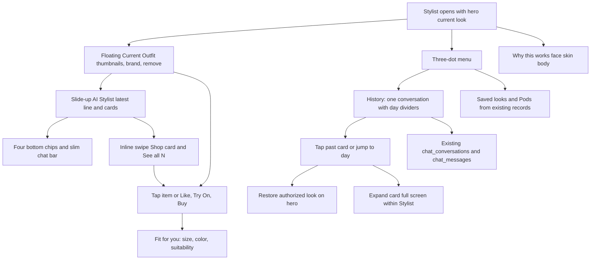

## Workflows
All wait ranges are rough estimates, not measured SLAs. Costs are per use: provider rates are not verified; no paid/live use is authorized by this plan.

### 1. Stylist chat turn — Workflow 1
**Approved by owner 2026-11-10, 10:18 AM PT.**
- Trigger/screen: The outfit-first Stylist hero, floating Current Outfit panel and compact AI Stylist sheet are visible by default; **full History is not**. Typing in the slim bottom bar or tapping one of four chips adds a short line or card to **one existing conversation**; the sheet expands for interaction and the bar only expands while typing. Older days appear through three-dot **History**, not a list of new chats.
- Calls and save: Read allowed profile/color/fit/style signals via lib/styleEngine.ts and existing profile state; route intents locally to advice, existing search or Pod, with a safe short reply. No new paid model by default. Append every authorized Stylist line/card to the **single** owner-scoped `chat_conversations(kind=stylist)` row and `chat_messages` using typed ID-only payloads; History reads that same conversation by date and card kind with day dividers. Keep legacy `kind=shop` history separate and do not duplicate canonical data.
- Wait/visible state: Estimated 0.5–2 s for a local answer or 2–5 s if reading profile data; show a short thinking line and keep the image visible.
- Failure: Missing profile or network -> generic advice with retry; do not invent scores.
- Cost per use: Local rules: $0 marginal API; database requests billed under existing Supabase plan; optional model requires later approval.

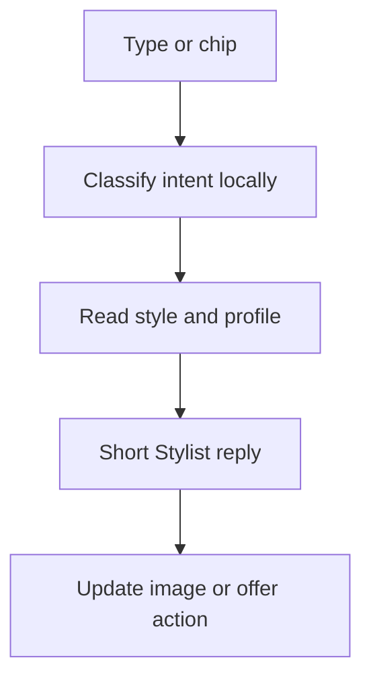

### 2. Elevate / Try On — Workflow 5
**Approved by owner 2026-11-10, 10:51 AM PT.**

- **Trigger/screen:** The **Elevate Your Look** row appears **only after** a closet look, earlier try-on, or tomorrow's look is already the Stylist's main image. **Never show the row on an empty screen.** Tap **Try On** on a row item. The **on-screen look image is always `human_img`**; no “upload body photo” branch in this workflow (WF2 handles body-photo collection).
- **Items/calls:** Only active garments from `lib/garmentUtils.js` -> `GET /api/garments?active_only=true` -> `garments`, each with an image and a category mappable to PR #4. Rank with the current look, style fingerprint and color season using `lib/styleEngine.ts`. **No SerpAPI** for Elevate. Keep the row short, with its exact count set by the owner's mockup/Thanmayi Figma (not guessed here).
- **Fit on interest:** Row cards always show **photo, brand, price and Try On**, with **no size, color rating or face/body suitability** beforehand. Tapping a Current Outfit item also opens the same interest-gated Fit for you card. **Tapping Try On is interest**: then run existing Fit Check `lib/fitLogic.js` with available measurements and size chart, display its supported size + one fit note; otherwise show a saved profile size labeled **“your profile size”**, or **“size not confirmed”** with Fit Profile prompt (WF4). Never invent a size or size all items.
- **Prepare inputs:** Require a signed-in owner, validate the on-screen human image and garment. PR #4 rejects external garment image URLs and has an **empty catalog allowlist**: first call `lib/upload.ts` **`uploadRemoteImage`** to copy the chosen remote garment image into the signed-in user's own Storage path, verifying ownership. Reuse the category map already in `App.js`: `upper|upper_body → upper_body`, `lower|lower_body → lower_body`, `dress|dresses → dresses`. If the category is unmappable, **do not call** the API.
- **Generate:** Call PR #4's injected client (`lib/tryonClient.ts` -> `lib/tryon.ts` `startTryOn`) with `POST /api/tryon` body `{human_img, garm_img, category}`. Only `STYLIT_TRYON_TEST_ENABLED` plus **reviewed TEST identity/configuration pins** can enable this. **No new model client or edits to PR #4 files.** The create call generates synchronously and returns **`jobId` as an owner-bound completion receipt**. `pollTryOn(jobId)` -> `GET /api/tryon/<jobId>` **only verifies** that receipt/result; it does **not** start another generation. The receipt expires after **15 minutes**; do not assume it is a long-running job.
- **Save/display:** Replace the main look image with the successful result. Use PR #4's `lib/tryOnHistory.ts` `saveTryOnHistory({receipt: jobId, ...})` -> **`POST /api/tryon/history`**. Its server owns `try_on_history` inserts; **never insert from the app**. If history saving fails, **keep the new photo visible and show a warning**, without pretending history saved. **Optional `user_events` row decision: do not add one in Workflow 5**; preserve existing approved style events where applicable, and avoid a new table/write.
- **Wait/screen:** **Estimated 10–20 s**, unmeasured. Keep the previous main photo visible during generation, show a short progress line, and ask **one optional style question**. Save an answer to the user's style profile following WF2; **never wait for an answer** before generating. After success, swap the photo.
- **Failures:** Not signed in -> request sign-in; TEST gate off or `TEST_NOT_CONFIGURED` -> **“not available yet”**, with **no fake image**. Remote image copy or ownership check fails -> **“can't try on this item”** and offer another item. Unmappable category -> exclude it / no API call. `FORBIDDEN`, `TIMEOUT`, `RATE_LIMIT`, `PROVIDER_FAILURE`, `STORAGE_FAILURE` (or receipt expiry) -> keep the old photo and **Retry that item only**; no unrelated retries. History-save failure is a **warning after a successful photo**, not a failed generation.
- **Cost/limits:** **~$0.03–$0.04 per try-on (unverified estimate)**, plus storage/traffic. Add a **server-enforced per-user daily generation cap before go-live**, with a safe disabled default until the owner authorizes a limit and paid/live access. Use test mocks and no unapproved provider use.
- **Task gates:** Requires [MVPStyli PR #4](https://github.com/killbill2792/MVPStyli/pull/4) **merged and proven**, **both migrations applied and verified**: `scripts/migrations/20261031_server_only_try_on_history_writes.sql` and `scripts/migrations/20261105_current_user_image_ownership_rpc.sql`. Never edit any PR #4 file. `STYLIT_TRYON_TEST_ENABLED` and TEST pins remain mandatory; owner separately approves go-live.

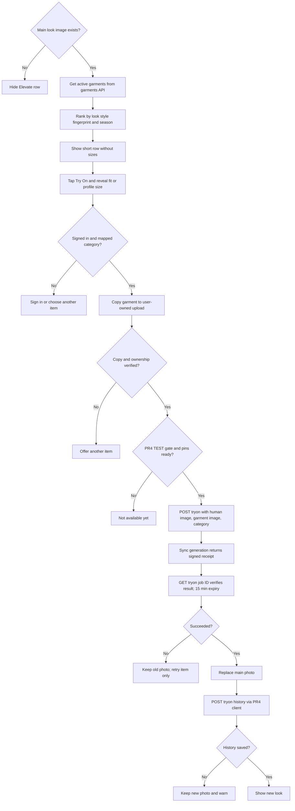

### 3. Product search — inline Shop card
**Search behavior pending owner review; inline Shop presentation approved by owner 2026-11-10, 11:24 AM PT.**
- Trigger/screen: User asks “show me a polka dot dress” or another product search in the bottom chat; AI Stylist displays an **inline Shop card** in its slide-up conversation sheet, not a new page or separate catalog sheet.
- Calls and save: For catalog inventory call `lib/garmentUtils.js` -> `GET /api/garments?active_only=true` -> `garments`/`garment_sizes`; if appropriate use existing `lib/productSearch.ts` -> `POST /api/searchwebproducts` -> SerpAPI only under WF4 search cap/go-live gate. Normalize the valid results. Append a `chat_messages.card_type=shop` ID-only reference in the one Stylist conversation, not a copied product catalog. Never merge legacy Shop chat history.
- UI and wait: Estimated **1–3 s catalog**, **2–5 s web**; show a small loading placeholder **inside the sheet**. Results are a **horizontal swipe row** with photo, brand, price, Try On, Buy, and **“See all N”** to reveal remaining real results in-place (not a new Shop route). Show no size/fit before item interest; after Try On/Like/Buy, open **Fit for you** for just that item.
- Failure: Search key missing/network down -> eligible local catalog results or a real empty state with Retry. Missing links/known out-of-stock disable Buy; never fabricate products, sizes or links.
- Cost per use: Existing catalog fetch **$0 marginal search-provider fee**; SerpAPI cost only if enabled, **~$0.01–$0.02/search unverified**, capped per user; no live keys before go-live.

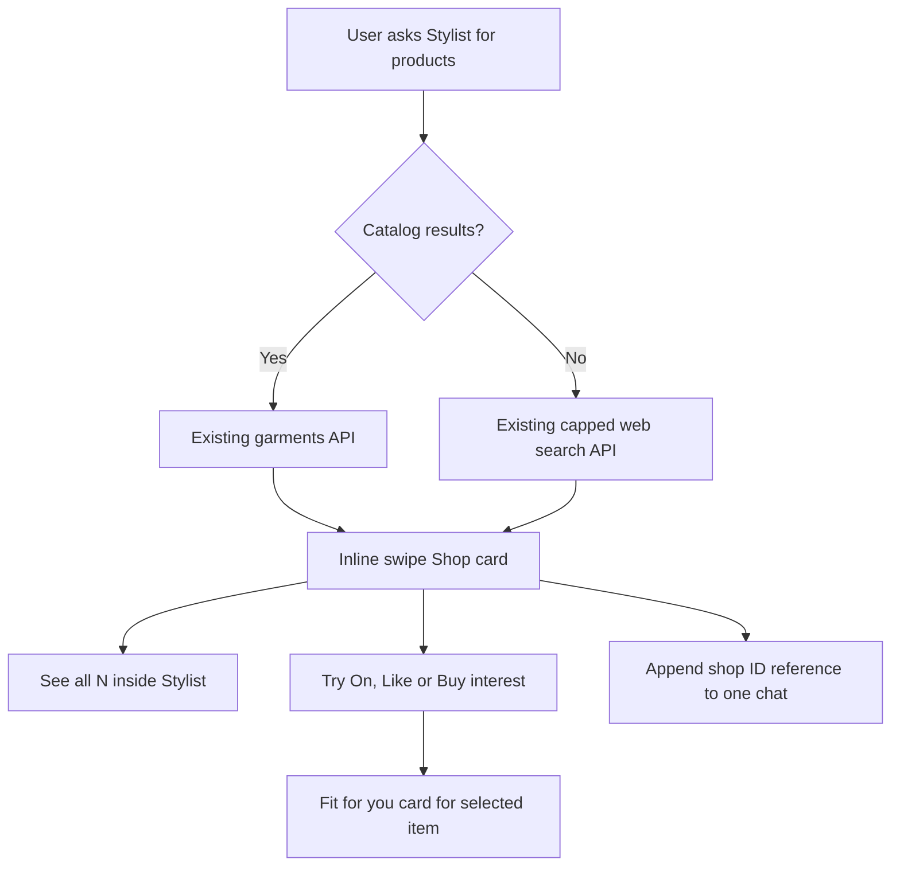

### 4. Proactive Pod suggestion — Workflow 6
**Approved by owner 2026-11-10, 11:05 AM PT.**

- **Trigger/screen:** After a real look appears in the Stylist hero from **WF2 closet**, **WF5 try-on**, or **WF3 tomorrow's look**, make the suggestion **at most once for that look**; also accept **Send to Pod** and **“run a Pod”** for an on-screen look. If there is no look, **hide** the offer and Pod action. **No** is a permanent decline **for this look** across reloads; do not re-offer it.
- **Stylist line:** **“I like this. Want a quick vote? I'd go Global.”** No look-level score exists in the app; never invent a score or imply a rating. Say **“this matches your style”** **only if** the look's actual tags/colors/category overlap the user's `user_style_profile` (`top_style_tags`, `top_colors`, `top_categories`) using the same matching evidence as `get_users_good_at_style` in `scripts/CREATE_GET_USERS_GOOD_AT_STYLE.sql` and `lib/pods.ts`. If no verified overlap or metadata is missing, omit that claim.
- **Ready card, no typing or route change:** Inline **Pod ready** card in the current AI Stylist sheet, persisted to the one history, rendered to **match the final Live Pod card**: current hero look as the default image, auto-filled title (for example **“Date night look?”**), audience label **Global** (`pods.audience='global_mix'`), **15 minutes** (`duration_mins=15`, `ends_at` at creation), and **Edit / Go live** buttons. No separate `createpod` page. **Edit** means tapping title, audience or timer **directly on the card**; offer existing **Friends / Style Twins / Global** options and existing supported timer choices. Edits remain unsaved draft state until Go live; **Cancel creates no Pod and writes nothing**.
- **Calls:** `lib/styleEngine.ts` `getStyleProfile` or `user_style_profile` to verify any style claim; inline card preloads valid photo and metadata. Only on **Go live**, require signed-in owner and call existing `lib/pods.ts` `createPod({owner_id,image_url,title,audience,duration_mins,ends_at,product_tags,product_colors,product_category})`. Use a single-flight Go-live guard, stable look-based idempotency key and server-reconciled uniqueness so repeated taps/retries **cannot insert two `pods` rows**. The created `pods.id` is the sole source for subsequent rendering. **No PR #4 merge or image generation is needed for Pod wiring**; test with a preexisting/mock look reference.
- **After Go live:** Replace the visible ready state with an inline **Live Pod** card in the AI Stylist sheet (append a `pod_live` history reference, do not rewrite the old timeline row). Show timer from `ends_at` plus **live yes/maybe/no** using existing `getPodVotes`, `getVoteCounts` and `subscribeToPodVotes` from `lib/pods.ts`; unsubscribe cleanly. Reuse `lib/share.ts` for share sheet/guest link, `api/pod-public/index.ts` and `api/pod-guest-vote/index.ts` for guests, `createPodInvites` and `lib/friends.ts` `createNotification` for Friends, and existing `screens/PodRecap.js`/ `calculateConfidence` data for recap; render updates in Stylist, with **a full-screen in-screen Pod expansion when tapped, not a new primary page**. Empty Friends list **must not prevent Pod creation**. Sharing/invites are after successful create; share errors do not roll it back.
- **Saved:** The canonical `pods` row is created **only on Go live**. Existing `pod_votes`, `pod_invites`, notifications and recap stay in existing tables. In `chat_messages` append ID-only references for each short Stylist line and rendered card: **`pod_ready`** with `look_id`, **`pod_live`** with real `pod_id`, and **`pod_declined`** with `look_id` on **No**. The ready history row does **not** create a draft Pod. Store no duplicate Pod, vote, `try_on_history`, `user_events`, or style-profile records. **Cancel writes no new row at all**. Keep historical records append-only and dedupe ready/live events by look/action.
- **Wait and visual state:** Rough, unmeasured **0–1 s** for a local ready card; **1–3 s** for Go live/Supabase creation, and live votes update as they arrive. Show Go live loading/disabled to prevent double taps; keep the hero and current AI Stylist sheet visible; tap the card to open the full-screen in-screen Pod. History remains hidden by default and is accessible from the three-dot menu. Share sheet is an overlay, not a new primary page.
- **Failures:** No current look -> no offer or button; not signed in -> sign-in request before Go live; `createPod` returns null/fails -> explain and **Retry**, leave card ready and **never fabricate a Pod or votes**; empty friends -> create anyway; share/invite failure -> Pod **remains live** in-thread and allow Retry Share. **No** remembers the decline permanently for that specific look; Cancel does nothing in the database. Never show fit information until Like/Try On/Buy under WF4.
- **Cost per use:** **~$0 additional model/provider cost (estimate)**; existing Supabase Pod, invite, vote and timeline reads/writes only. No separate PR #4 dependency.
- **Test:** No offer without real look; one offer per look including reload and persisted No; no Pod insert before Go live; Edit changes inline values; Go live creates **exactly one `pods` row** even after double tap/retry; timeline appends a row per card and uses IDs only; actual live subscription and cleanup; never a made-up score.

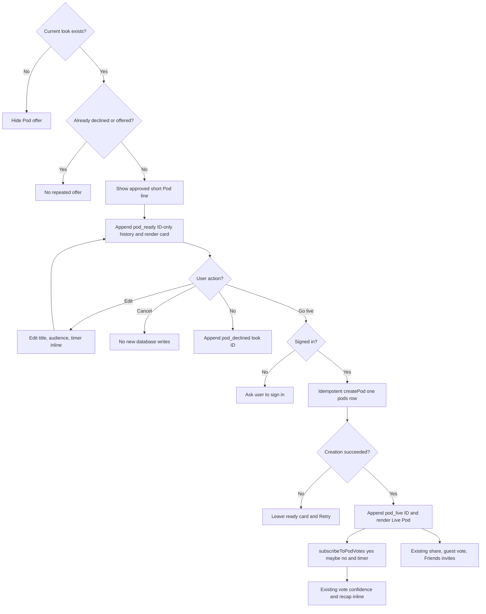

### 5. Style my closet — Workflow 2: closet + three looks
**Approved by owner 2026-11-10, 10:22 AM PT.**

- Trigger/screen: On Stylist, tap **Style my closet**. Enforce upload of **3–4 clothing photos** (not fewer or more). If `profiles.body_image_url` is missing, ask for a full-body photo first. Generation **starts immediately after upload**; no More Looks tap. More Looks retains its separate meaning.
- Calls: On the existing upload path, store user-owned closet photos; read `profiles`, style fingerprint from `lib/styleEngine.ts`, color season, and manual Fit Profile. A **server-side text LLM: OpenAI GPT-4.1 mini, called only by a gated Vercel endpoint** `api/stylist-looks/index.ts` (proposed, not yet installed or approved for live/paid use), reads the photos and those signals and plans three outfits: **Closet** uses only uploaded items; **Elevated** uses a closet base plus 1–2 pieces from `GET /api/garments`; **Makeover** uses entirely new pieces in a style not seen in the user's recorded fingerprint. If the fingerprint cannot show a genuinely new style, mark the result as a suggestion, not a verified first.
- During generation: Ask one question, e.g. “Where are you wearing this — class, date, party?” Save any answer to the user's style profile and use it to shape the looks if it arrives before outfit planning completes; if the user skips or answers later, do not pause generation (use the next run for a late answer). Start the planning request immediately, with a short opportunity for the answer; do not wait for an answer.
- Image calls: The image path in PR #4 accepts **one garment image**. Add a **separate server-side composition step** `api/_lib/stylistOutfitComposite.ts` to combine each outfit's pieces into one garment image; do not edit PR #4's files. Submit the three composites to **PR #4's gated Nano Banana try-on path in parallel**. Never call the image model directly from new code.
- Saved: New **private `closet_items`** table (`user_id`, private per-user storage `image_path`, `type`, `color`, `created_at`) with Supabase RLS and per-user storage rules; **never mix with `garments`**. Three resulting looks go into `try_on_history` by PR #4's **server-only writes**. Save the optional answer to the user's style profile under its ownership rules.
- Wait/screen: **Estimated ~20–30 s total** for three parallel image generations, plus upload/planning/composition time; **rough, unmeasured estimate**, not an SLA. Ask the style question while images load. Show **three swipe cards under the main photo**; tapping one promotes it to the main image. Each card has **Send to Pod** with **Global suggested**, using existing Pod creation after confirmation.
- Failure: If one look fails, show the other two; put **Retry** on the failed card only. If missing full-body photo, fewer/more than 3–4 images, missing consent, or TEST gate disabled, explain the issue without submitting an image. Preserve successful looks.
- Cost per run: **1 text LLM call + 3 image generations**, plus composition, storage and API traffic. Model/image charges are **estimated, not priced or authorized**; use mocks until the relevant service gate is approved. Keep `STYLIT_TRYON_TEST_ENABLED` required for TEST; no production/live use until owner go-live approval.

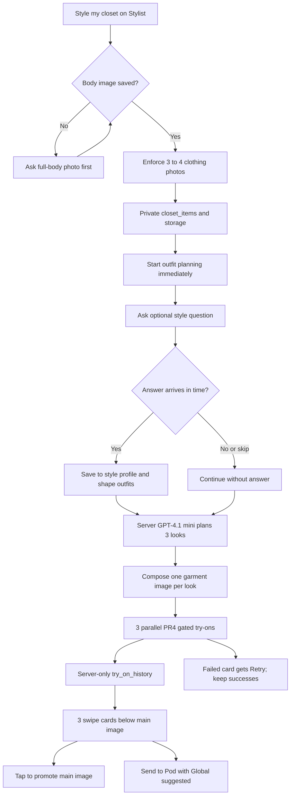

### 6. Tomorrow's look — Workflow 3
**Approved by owner 2026-11-10, 10:36 AM PT.**

- Trigger/screen: An **hourly Supabase pg_cron** job finds opted-in users whose IANA `profiles.timezone` local hour is **21:00**, who were active in the **last 7 days**, and who have not had tomorrow's local date processed. It enqueues **one independent job per user** for the existing Vercel backend. Never send one long batch to Vercel (**30 s function limit**). At sign-in, the app saves the device's IANA time zone and city/coarse location into new `profiles.timezone` and `profiles.city` fields; refresh on later sign-ins. No Dave or external bots. Only run scheduling after owner go-live approval.
- Calls/inputs: Supabase `pg_cron` -> per-user authenticated/gated `api/stylist-tomorrow/index.ts` worker. Read user-owned `closet_items`, style fingerprint via `lib/styleEngine.ts`, color season, manual Fit Profile and full-body image from `profiles`. Weather: **Open-Meteo** free city forecast **for testing only**; its commercial plan or another provider is a separate owner go-live decision. Event: (a) what the user told the Stylist about tomorrow (saved in their style profile); (b) if opted in, titles and times of next-day calendar events from **expo-calendar on device**, read at the **last app open** and synced privately to the server. No backend calendar scraping. Calendar data may be stale; label or omit it when so.
- Pick/image: Reuse Workflow 2's **server-side OpenAI GPT-4.1 mini** outfit picker to choose **one look** from closet, fingerprint, color and fit. Use Workflow 2's server composition step to make **one multi-piece garment image**, then call **only PR #4's gated Nano Banana try-on path**. Retry the generation **once** if it fails, then skip that night. Never edit PR #4 files or bypass its server-only history writes.
- Saved: New private `tomorrow_looks` table: `user_id`, `local_date` (**unique with user_id**), `look_items`, private `image_path`, `weather`, `event`, `status`; RLS/user ownership and idempotent upsert prevent duplicate nightly jobs. Keep a try-on entry in `try_on_history` **server-only through PR #4**, and an in-app notifications row. Save Expo push tokens **per device** in a private `device_push_tokens` table (or a per-device profile-linked equivalent); enforce user ownership, token rotation and opt-out.
- Wait/screen: Scheduled backend work, **not a user wait**. Rough estimate **20–30 s for one full try-on request**, excluding queue/weather/planning, and subject to Vercel's **30 s per-request limit**; split work into short independent jobs and persist status instead of timing out. Expo push is **text only**: **“Tomorrow's look is ready.”** An image inside the iOS notification requires a Notification Service Extension and a separate go-live decision.
- Open: Tapping the push or in-app row opens the **Stylist** screen with tomorrow's image as the main photo, one concise reason (e.g. “58° and an interview — polished but warm”), and **Wear it / Show me more / Send to Pod** buttons. Suggest **Global** for Pod, but create it only on confirmation.
- Failure: No closet -> push invites user to **add 3 photos**; no full-body photo -> ask for one. If push permission is denied, keep the look in-app without a push. If weather/calendar are unavailable or stale, use only available authorized signals and mark the reason accordingly. If generation fails, retry **once**, then mark skipped for that night; never send a false ready notice. Deduplicate retries and isolate jobs so one user never blocks another.
- Cost per eligible active user/night: **~$0.04–$0.06, rough estimate only**, for one text-LLM pick, one image generation (up to one retry), weather, Supabase, Vercel and push usage. Cost and provider rights need validation. Schedule **only users active within 7 days**. Run with mocks and no external sends until the owner's final go-live approval. Gate image use behind `STYLIT_TRYON_TEST_ENABLED` in TEST.

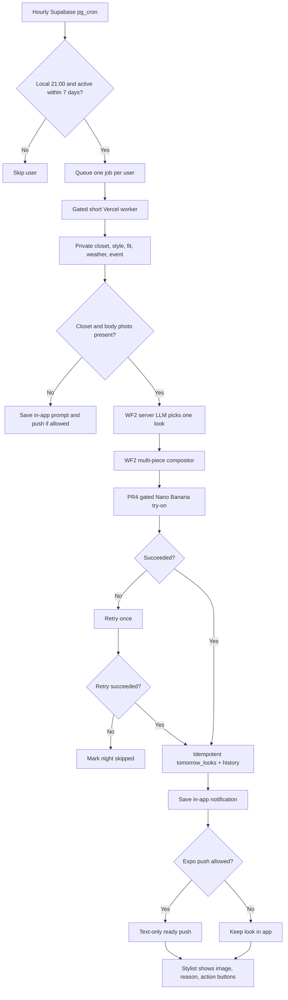

### 7. Find and buy — Workflow 4
**Approved by owner 2026-11-10, 10:40 AM PT.**

- **Trigger/screen:** Say **“I found this”** once when a **new shoppable look** is on the Stylist main image: after an Elevate Try On, an Elevated/Makeover closet look, or tomorrow's look. **Never on app open and never twice for the same look** (track the last offered look ID). Also respond when a user asks “find me a black jacket,” “buy this,” or “shop this.” The call-to-action is **Buy**, not “Shop this item.” The existing product search remains an **inline swipeable Shop card** in the AI Stylist conversation, with **See all N**, not a separate sheet or page.
- **Calls/picks:** Search the existing catalog **first** through `lib/garmentUtils.js` -> `GET /api/garments?active_only=true` -> `garments` and `garment_sizes`. Consider **only items with a real `product_link`**. If no relevant catalog result, make **one** fallback call through `lib/productSearch.ts` -> `POST /api/searchwebproducts` -> existing SerpAPI Google Shopping default. Reuse `lib/styleEngine.ts` for the style fingerprint and combine with color season and the current look for ranking; do not invent a style score or add a shopping API. Limit web searches **per user** and enforce the cap before calling the provider; no live search or keys until go-live approval.
- **Display before interest:** The Current Outfit thumbnails and Shop/look cards show photo, brand and price with **no size, color Fit Check, or suitability verdict before interest**. On the Stylist screen show an over-outfit card: photo, brand, price, one honest line about why the item suits the look (no made-up score), **Try On** and **Buy**. Do not run Fit Check for every search result. Hide Buy for a product known to be out of stock; say **unavailable** and offer another pick.
- **Interest / Fit Check:** Run sizing **only** after the user taps **Try On**, says/taps **“I like this”**, or says/taps **Buy** for that item. If profile measurements **and a usable size chart** exist, call `lib/fitLogic.js` **`recommendSizeAndFit`** with `garment_sizes` (catalog) or `lib/brandSizeCharts.js` / `brand_size_charts` (web item) and display **the recommended size plus one fit note**. On `INSUFFICIENT_DATA`, absent measurements or unavailable chart, show `profiles.top_size` or `profiles.bottom_size` as **“your profile size”** if appropriate; otherwise show **“size not confirmed”** and a short prompt to complete Fit Profile. Never guess sizes or block on live OCR. Show a small **Fit for you** card **only for the interested item**: that supported size plus one fit note, `lib/colorScoring.js` `computeColorScore` skin-tone verdict great/good/ok/risky when enough data exists, and one supported face/body suitability line from `lib/styleSuitability.js` `evaluateSuitability`. A tap on a Current Outfit item also counts as interest. On insufficient data say so rather than invent a score. **Why this works** on the hero opens the full verified face/skin/body summary. No other cards gain fit details.
- **Try On:** Use **only MVPStyli PR #4** try-on path, and only behind `STYLIT_TRYON_TEST_ENABLED` until the owner's go-live OK. On failure keep the original card/image and offer **Retry Try On** only.
- **Buy V1:** After the interest sizing step, use `Linking.openURL` on a validated `product_link` (catalog) or `productUrl` (web). No payment charge, no in-app checkout. Keep the shown size in Stylit with a reminder like **“pick Size M on the store page”** when known; **do not claim** the merchant preselected it. No affiliate link rewriting in v1; future affiliate tracking requires a separate owner go-live approval.
- **Saved:** Create a new **private `buy_intents`** table with `user_id`, `title`, `brand`, `price`, `image`, `store_url`, `source` (`garments` or `web`), `size_shown`, `size_source` (`fitcheck`, `profile`, `unconfirmed`), `opened_at`, and user-scoped RLS. Write **once** when a valid Buy link is opened; deduplicate repeated taps for the same intent. Optionally write a `user_events` row. **Do not use the `products` table** or create payment/order tables.
- **Wait / visible state:** Rough estimates, not measured: **1–3 s catalog** or **2–5 s with one web search**; keep outfit and card visible with a small loading indicator. Fit Check uses existing local rules when data is available, with no mandatory OCR wait.
- **Failure:** No size data or `INSUFFICIENT_DATA` -> profile size or **“size not confirmed”**; known out-of-stock -> hide Buy and offer another pick; broken or missing link -> **unavailable** with no guessed URL; search down/no key -> valid catalog items or an empty state and **Retry**, never fake products; Try On failure -> preserve card, Retry Try On only. Do not insert buy intent for an invalid link.
- **Cost per use:** Catalog lookup **$0 marginal search-provider cost** (existing backend use); SerpAPI roughly **$0.01–$0.02/search**, **unverified estimate**. Only one fallback search per request under a per-user cap; test with mocked search and keep live search and secrets disabled until owner go-live approval. V1 Buy itself never charges the user.

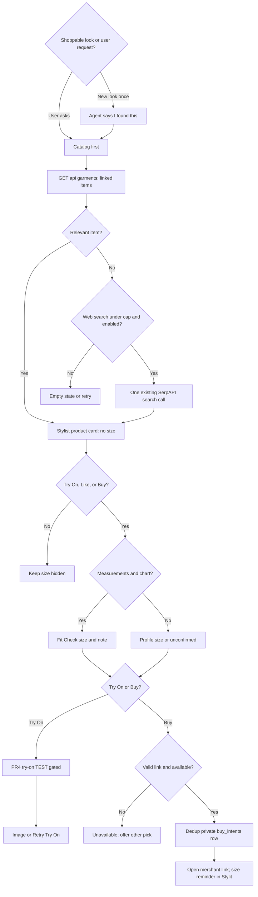

### 8. Mix & Match chip
**Pending owner review.**
- Trigger/screen: Tap Mix & Match on Stylist; show outfit combinations beneath the main image.
- Calls: Read permitted wardrobe/garments using `lib/garmentUtils.js` and `GET /api/garments`; rank combinations with `lib/styleEngine.ts`. Optional Try On uses only PR #4's gated path.
- Saved: Chosen items stay in local screen state; a generated image is saved server-only to owned `try_on_history`, not `garments`.
- Wait/visible state: Estimated 1–3 s for picks or 10–20 s for Try On; show cards while keeping the main image, then a progress message.
- Failure: No matching items -> offer manual choices; try-on failure -> retain old image with Retry.
- Cost per use: No new model charge for matching; one image-generation charge only if Try On runs (amount unverified).

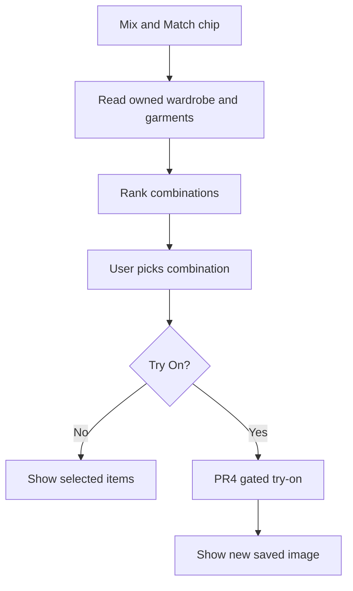

### 9. Color Analysis chip
**Pending owner review.**
- Trigger/screen: Tap Color Analysis; show an inline palette panel on Stylist.
- Calls: Read `profiles` color season via `lib/colorAnalysis.ts`. If absent, offer the existing `api/analyze-skin-tone/index.ts` face-analysis flow only with consent.
- Saved: A read saves nothing; existing profile color fields update only through the existing analysis path.
- Wait/visible state: Estimated 0.5–2 s for saved colors, 5–15 s if analysis requested; show palette or a progress state while outfit stays visible.
- Failure: Missing face image, permission or API -> show unknown season and existing profile setup option.
- Cost per use: Normal profile read; optional existing analysis may have unverified API charges.

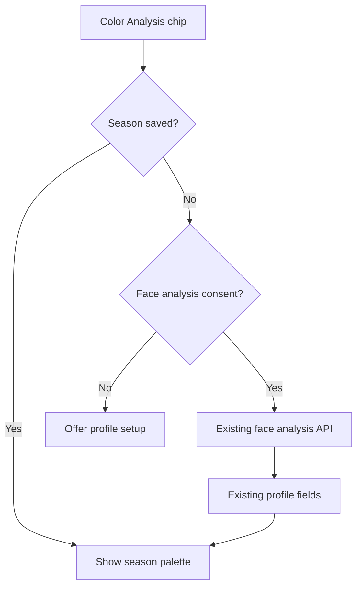

### 10. Style Advice chip
**Pending owner review.**
- Trigger/screen: Tap Style Advice; open a short panel on Stylist with current outfit still in view.
- Calls: Read `lib/styleEngine.ts` fingerprint and `profiles` color/Fit Profile; apply existing `lib/fitLogic.js` rules locally. A later Try On tap must reuse PR #4.
- Saved: Nothing by default; only explicitly provided preference/answer is written to the user's style profile with ownership checks.
- Wait/visible state: Estimated 0.5–2 s for local advice or 2–5 s when loading profile; show one short thinking message.
- Failure: Missing profile -> label it general advice; fetch error -> offer retry, never fabricate a score.
- Cost per use: Local rules have no model-call charge; regular Supabase usage only.

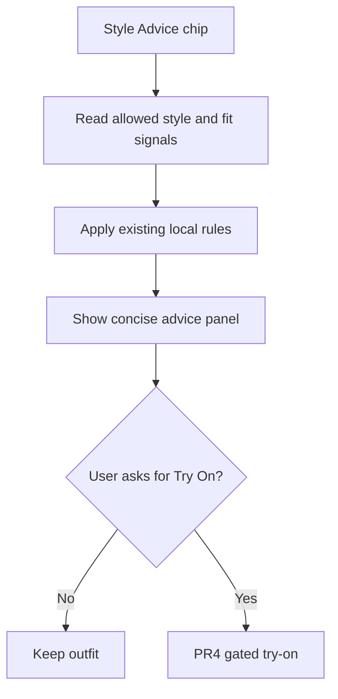

## Task and PR merge order
0a. Add a short rules-only AGENTS.md to MVPStyli linking to the canonical vision.
0b. Install required PR-body vision-version CI check before implementation PRs.
1. Map Shop, garments, navigation and PR #4 collision paths.
2. Build the **outfit-first** Stylist shell: hero, floating Current Outfit real thumbnails, bookmark/share, slide-up AI Stylist sheet, hidden-by-default History menu and four bottom chips/chat.
3. Apply verified owner mockup and Thanmayi theme/profile/wardrobe tokens (only after design access).
4. Wire chat intent, **one private per-user continuous Stylist conversation** (kind/card_type/ID payload migration and owner-only RLS), History by day/kind behind menu, and **inline swipe Shop card with See all N**.
6. Wire inline Pod ready/edit/live/recap and existing votes/shares, **independent of PR #4**.
5. Add Elevate only after an on-screen look; catalog-only ranked items, interest-gated fit, user-owned garment copy, PR #4 synchronous receipt, server history and per-user cap.
7. Style my closet: enforce 3–4 photos, optional body photo, gated GPT-4.1 mini planner, three composed images via parallel PR #4 try-ons, private closet_items with RLS, optional profile question, swipe cards and Send to Pod.
8. Add gated hourly Supabase pg_cron eligibility, per-user Vercel jobs, city/time zone, device calendar sync, Open-Meteo TEST weather, one WF2-composed try-on and text-only Expo push; keep mocked/dark until go-live.
9. Offer one-per-look “I found this” and Buy links, inline swipe Shop card, interest-only Fit for you (size, color and body/face) plus Why this works hero, and deduplicated buy_intents; no checkout.

## Notes
The **11:24 AM PT one-screen design update supersedes the 11:05 AM default-visible history**: the default is the hero/Current Outfit/AI Stylist sheet, with full history accessible only via the three-dot menu. Tap past cards for full-screen in-screen expansion and restore the hero as specified; old standalone routes remain for compatibility. History stays in **one per-user Stylist conversation** using only canonical record IDs and owner-only RLS; no new chat/history tables. Previously approved closet_items, tomorrow_looks and buy_intents tables are separate feature storage and remain in scope.

Workflows 1, 2, 3, 4, 5 and 6 **and the one-screen design** have owner approval dated 2026-11-10. All remaining feature workflows are pending owner review; these workflow approvals do not authorize live/paid use or merge this studio PR.

Task 2 must not write `App.js` until MVPStyli PR #4 is merged; if PR #4 remains open, use an isolated implementation that does not modify any PR #4 changed files. Task 6 follows Task 4, **not Task 5**, and has no direct or merge-order dependency on PR #4; use a mocked/existing look and preserve all current Pod services. Task 5 reads but never edits `App.js` or any PR #4 file and requires both PR #4 ownership/history SQL migrations applied. Tasks 7 and 8 require PR #4 merged; task 8 additionally requires PR #4's history SQL applied and task 7's private closet_items and composition proven. Both remain gated by `STYLIT_TRYON_TEST_ENABLED` until final go-live approval. Task 9's optional Try On also requires PR #4 merged and that TEST gate; live SerpAPI and credentials stay off until go-live.

Every coding PR body must contain exactly `Vision version: v1` until the current version changes. CI must read the **current** exec.md on the studio default branch and fail missing, stale or unrecognized versions; never use archive/. When the owner changes the vision, copy the previous full exec.md text into dated archive file marked SUPERSEDED, update current exec.md with a new version/date, and adjust plans/checks. Coding chats must never read archive/.

Each task is one PR in MVPStyli. Every task defines read-only `uses` and writable `edits`. Follow its AGENTS.md merge rules; wait until a parent is proven on default branch; rebase later tasks in order and fix clashes. Never edit PR #4 files. Since PR #4 changes `App.js` and `screens/StyleVaultScreen.js`, any task that needs them waits for its merge and bases on top; do not race it. Never add secrets. Merging this planning PR is feature-start approval, **not** production/paid approval.
