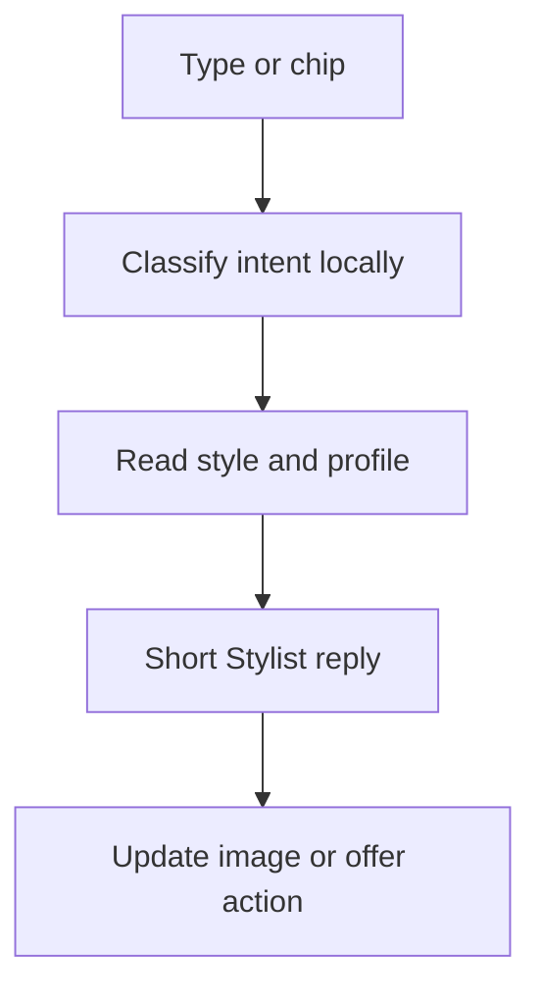
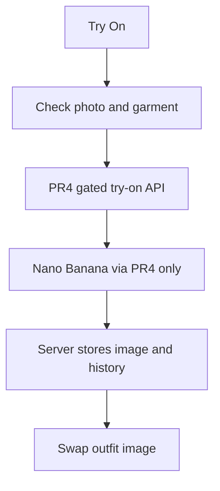
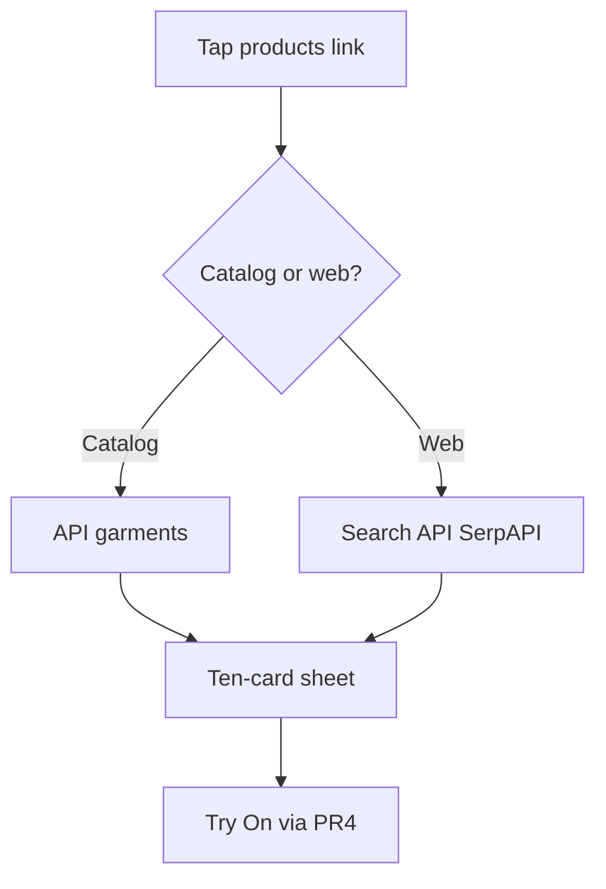
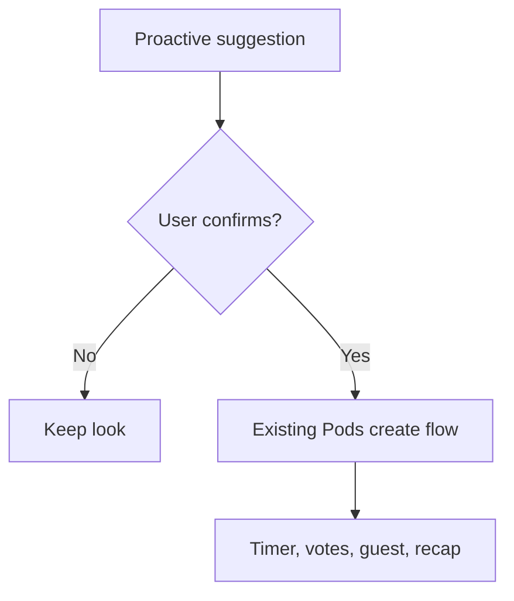
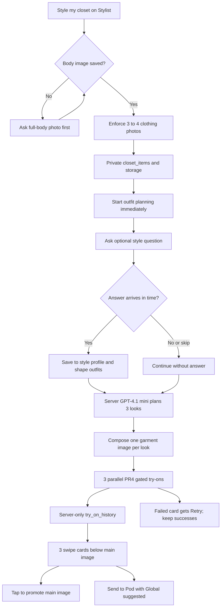
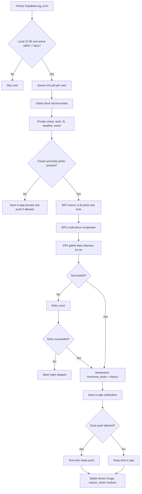
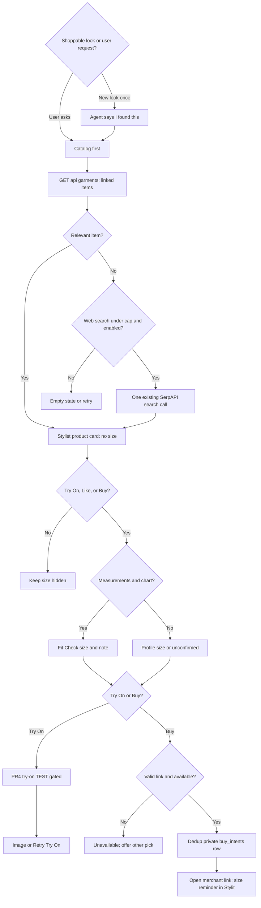
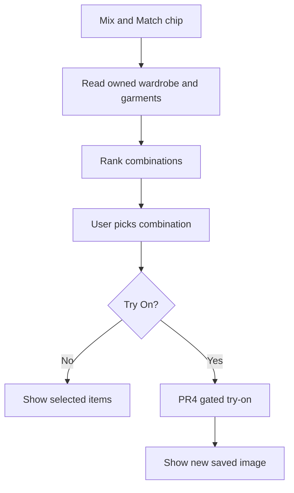
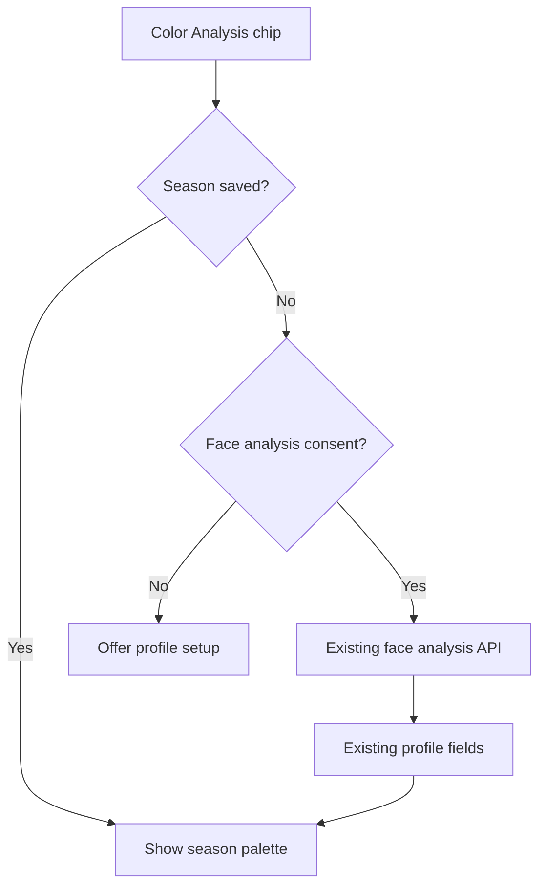
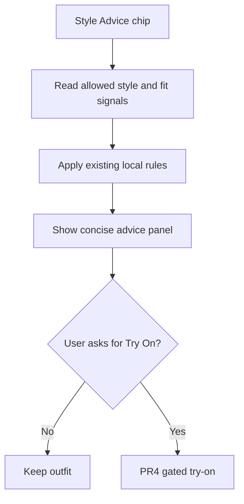

# Dev: Stylit Agent

Status: proposed; all code later in killbill2792/MVPStyli

## Current vision
Read [exec.md — v1](https://github.com/killbill2792/studio/blob/main/studio/ideas/stylit-agent/exec.md) for the only current vision. This file is implementation design, not a second vision.

## Architecture
The app uses `App.js` route state and `components/BottomBar.js`. `shop` shows an inline grid; `chat` shows `screens/ChatScreen.js`; `account` renders `screens/StyleVaultScreen.js`; `userprofile` renders `screens/UserProfileScreen.js`; `tryon`, `product`, `podshome`, `createpod`, `podlive`, `podguest` and `podrecap` remain. `screens/AccountScreen.js` is not the active account route. Preserve Explore and StyleCraft. Use a Stylist route in place of Shop, not a new app.

Current Shop: `App.js` calls `fetchGarmentsAsProducts` (`lib/garmentUtils.js`) for `GET /api/garments?active_only=true`; `api/garments/index.ts` reads `garments` and optional `garment_sizes`. The Shop grid opens `screens/ProductScreen.js`; Fit Check uses its size mapping and `lib/fitLogic.js`. `lib/productApi.js` contains older direct `products` writes; do not assume that table exists.

Reuse, do not rebuild: `screens/ChatScreen.js`, `lib/productSearch.ts` and `api/searchwebproducts/index.ts` (SerpAPI); `screens/PodsScreen.js`, `PodsHome.js`, `PodLive.js`, `PodGuest.js`, `PodRecap.js`, `lib/pods.ts` (friends/twins/global, timer, votes, guest votes and invites); `lib/colorAnalysis.ts` and `api/analyze-skin-tone/index.ts` (face/color season); `StyleVaultScreen.js` and profiles (manual Fit Profile); `lib/styleEngine.ts` (try-on/vote event fingerprint and style twins); `lib/fitLogic.js` and `components/AskAISheet.js` (rule-based Fit Check). PR #4 owns the only Nano Banana model call path.

```mermaid
flowchart TD
  UI[Stylist image, cards, chat and sheet] --> app[App route and existing context]
  app --> style[Style engine and profiles]
  app --> catalog[Garment and web-search APIs]
  app --> pod[Existing Pods screens and tables]
  app --> tryon[PR4 gated try-on server]
  tryon --> history[Owned storage and try_on_history]
  cron[Hourly Supabase pg_cron - gated] --> worker[One Vercel job per eligible user]
  worker --> tryon
  worker --> push[Text-only Expo push - gated]
```

## Workflows
All wait ranges are rough estimates, not measured SLAs. Costs are per use: provider rates are not verified; no paid/live use is authorized by this plan.

### 1. Stylist chat turn — Workflow 1
**Approved by owner 2026-11-10, 10:18 AM PT.**
- Trigger/screen: User types or taps a quick chip in the pinned bar; Stylist stays on the same screen.
- Calls and save: Read allowed profile/color/fit/style signals via lib/styleEngine.ts and existing profile state; route intents locally to advice, existing search or Pod, with a safe short reply. No new paid model by default. Only save conversation if using existing chat_conversations/chat_messages with the user's ownership checks.
- Wait/visible state: Estimated 0.5–2 s for a local answer or 2–5 s if reading profile data; show a short thinking line and keep the image visible.
- Failure: Missing profile or network -> generic advice with retry; do not invent scores.
- Cost per use: Local rules: $0 marginal API; database requests billed under existing Supabase plan; optional model requires later approval.



### 2. Elevate / Try On
**Pending owner review.**
- Trigger/screen: Tap Try On on an Elevate item; outfit image remains visible.
- Calls and save: Resolve garment/image and current person photo; server calls PR #4's gated /api/tryon adapter -> Nano Banana -> server-owned image storage and try_on_history. App polls existing status and swaps the displayed image on success.
- Wait/visible state: Estimated 10–20 s for one image (not measured); keep the prior image with progress and ask a style question.
- Failure: Missing photo, TEST gate, quota or failure -> preserve old image and offer retry; never write history client-side.
- Cost per use: Nano Banana provider charge per generation, amount unverified; storage and bandwidth extra. No call if gated.



### 3. Product catalog sheet
**Pending owner review.**
- Trigger/screen: Stylist says 'tap here to see products'; user taps the link on Stylist.
- Calls and save: For closet inventory use lib/garmentUtils.js -> GET /api/garments -> garments/garment_sizes; for web query use lib/productSearch.ts -> POST /api/searchwebproducts -> SerpAPI if configured. Normalize, cap near 10 and open a sheet. Try On hands product to existing try-on path.
- Wait/visible state: Estimated 1–3 s for catalog results; show ten skeleton slots while fetching and keep chat behind the sheet.
- Failure: Missing products table or search key -> empty-state and retry or closet catalog; no fake stock.
- Cost per use: Garment fetch uses existing backend; web search consumes SerpAPI credits if enabled, price unverified; offline tests mock it.



### 4. Proactive suggestion to Pod
**Pending owner review.**
- Trigger/screen: Stylist says exactly: “I like this, your style intelligence also rates it high. If you have doubts I can run a Pod; I'd suggest Global.” User says Yes before a Pod starts.
- Calls and save: Get style fingerprint via lib/styleEngine.ts and image from existing try-on; on confirmation open existing createpod route in screens/PodsScreen.js, then lib/pods.ts createPod plus existing invites/votes/recap. Offer Global, friends or twins; no silent Pod creation.
- Wait/visible state: Estimated 1–3 s to create a confirmed Pod; show progress before entering the existing timer/live route.
- Failure: No image, account or create error -> keep suggestion and explain; allow manual retry.
- Cost per use: No new model call; Supabase writes and storage under existing plan; votes add ordinary requests.



### 5. Style my closet — Workflow 2: closet + three looks
**Approved by owner 2026-11-10, 10:22 AM PT.**

- Trigger/screen: On Stylist, tap **Style my closet**. Enforce upload of **3–4 clothing photos** (not fewer or more). If `profiles.body_image_url` is missing, ask for a full-body photo first. Generation **starts immediately after upload**; no More Looks tap. More Looks retains its separate meaning.
- Calls: On the existing upload path, store user-owned closet photos; read `profiles`, style fingerprint from `lib/styleEngine.ts`, color season, and manual Fit Profile. A **server-side text LLM: OpenAI GPT-4.1 mini, called only by a gated Vercel endpoint** `api/stylist-looks/index.ts` (proposed, not yet installed or approved for live/paid use), reads the photos and those signals and plans three outfits: **Closet** uses only uploaded items; **Elevated** uses a closet base plus 1–2 pieces from `GET /api/garments`; **Makeover** uses entirely new pieces in a style not seen in the user's recorded fingerprint. If the fingerprint cannot show a genuinely new style, mark the result as a suggestion, not a verified first.
- During generation: Ask one question, e.g. “Where are you wearing this — class, date, party?” Save any answer to the user's style profile and use it to shape the looks if it arrives before outfit planning completes; if the user skips or answers later, do not pause generation (use the next run for a late answer). Start the planning request immediately, with a short opportunity for the answer; do not wait for an answer.
- Image calls: The image path in PR #4 accepts **one garment image**. Add a **separate server-side composition step** `api/_lib/stylistOutfitComposite.ts` to combine each outfit's pieces into one garment image; do not edit PR #4's files. Submit the three composites to **PR #4's gated Nano Banana try-on path in parallel**. Never call the image model directly from new code.
- Saved: New **private `closet_items`** table (`user_id`, private per-user storage `image_path`, `type`, `color`, `created_at`) with Supabase RLS and per-user storage rules; **never mix with `garments`**. Three resulting looks go into `try_on_history` by PR #4's **server-only writes**. Save the optional answer to the user's style profile under its ownership rules.
- Wait/screen: **Estimated ~20–30 s total** for three parallel image generations, plus upload/planning/composition time; **rough, unmeasured estimate**, not an SLA. Ask the style question while images load. Show **three swipe cards under the main photo**; tapping one promotes it to the main image. Each card has **Send to Pod** with **Global suggested**, using existing Pod creation after confirmation.
- Failure: If one look fails, show the other two; put **Retry** on the failed card only. If missing full-body photo, fewer/more than 3–4 images, missing consent, or TEST gate disabled, explain the issue without submitting an image. Preserve successful looks.
- Cost per run: **1 text LLM call + 3 image generations**, plus composition, storage and API traffic. Model/image charges are **estimated, not priced or authorized**; use mocks until the relevant service gate is approved. Keep `STYLIT_TRYON_TEST_ENABLED` required for TEST; no production/live use until owner go-live approval.



### 6. Tomorrow's look — Workflow 3
**Approved by owner 2026-11-10, 10:36 AM PT.**

- Trigger/screen: An **hourly Supabase pg_cron** job finds opted-in users whose IANA `profiles.timezone` local hour is **21:00**, who were active in the **last 7 days**, and who have not had tomorrow's local date processed. It enqueues **one independent job per user** for the existing Vercel backend. Never send one long batch to Vercel (**30 s function limit**). At sign-in, the app saves the device's IANA time zone and city/coarse location into new `profiles.timezone` and `profiles.city` fields; refresh on later sign-ins. No Dave or external bots. Only run scheduling after owner go-live approval.
- Calls/inputs: Supabase `pg_cron` -> per-user authenticated/gated `api/stylist-tomorrow/index.ts` worker. Read user-owned `closet_items`, style fingerprint via `lib/styleEngine.ts`, color season, manual Fit Profile and full-body image from `profiles`. Weather: **Open-Meteo** free city forecast **for testing only**; its commercial plan or another provider is a separate owner go-live decision. Event: (a) what the user told the Stylist about tomorrow (saved in their style profile); (b) if opted in, titles and times of next-day calendar events from **expo-calendar on device**, read at the **last app open** and synced privately to the server. No backend calendar scraping. Calendar data may be stale; label or omit it when so.
- Pick/image: Reuse Workflow 2's **server-side OpenAI GPT-4.1 mini** outfit picker to choose **one look** from closet, fingerprint, color and fit. Use Workflow 2's server composition step to make **one multi-piece garment image**, then call **only PR #4's gated Nano Banana try-on path**. Retry the generation **once** if it fails, then skip that night. Never edit PR #4 files or bypass its server-only history writes.
- Saved: New private `tomorrow_looks` table: `user_id`, `local_date` (**unique with user_id**), `look_items`, private `image_path`, `weather`, `event`, `status`; RLS/user ownership and idempotent upsert prevent duplicate nightly jobs. Keep a try-on entry in `try_on_history` **server-only through PR #4**, and an in-app notifications row. Save Expo push tokens **per device** in a private `device_push_tokens` table (or a per-device profile-linked equivalent); enforce user ownership, token rotation and opt-out.
- Wait/screen: Scheduled backend work, **not a user wait**. Rough estimate **20–30 s for one full try-on request**, excluding queue/weather/planning, and subject to Vercel's **30 s per-request limit**; split work into short independent jobs and persist status instead of timing out. Expo push is **text only**: **“Tomorrow's look is ready.”** An image inside the iOS notification requires a Notification Service Extension and a separate go-live decision.
- Open: Tapping the push or in-app row opens the **Stylist** screen with tomorrow's image as the main photo, one concise reason (e.g. “58° and an interview — polished but warm”), and **Wear it / Show me more / Send to Pod** buttons. Suggest **Global** for Pod, but create it only on confirmation.
- Failure: No closet -> push invites user to **add 3 photos**; no full-body photo -> ask for one. If push permission is denied, keep the look in-app without a push. If weather/calendar are unavailable or stale, use only available authorized signals and mark the reason accordingly. If generation fails, retry **once**, then mark skipped for that night; never send a false ready notice. Deduplicate retries and isolate jobs so one user never blocks another.
- Cost per eligible active user/night: **~$0.04–$0.06, rough estimate only**, for one text-LLM pick, one image generation (up to one retry), weather, Supabase, Vercel and push usage. Cost and provider rights need validation. Schedule **only users active within 7 days**. Run with mocks and no external sends until the owner's final go-live approval. Gate image use behind `STYLIT_TRYON_TEST_ENABLED` in TEST.



### 7. Find and buy — Workflow 4
**Approved by owner 2026-11-10, 10:40 AM PT.**

- **Trigger/screen:** Say **“I found this”** once when a **new shoppable look** is on the Stylist main image: after an Elevate Try On, an Elevated/Makeover closet look, or tomorrow's look. **Never on app open and never twice for the same look** (track the last offered look ID). Also respond when a user asks “find me a black jacket,” “buy this,” or “shop this.” The call-to-action is **Buy**, not “Shop this item.” The existing ~10-item catalog sheet from Workflow 1 remains the browsing path.
- **Calls/picks:** Search the existing catalog **first** through `lib/garmentUtils.js` -> `GET /api/garments?active_only=true` -> `garments` and `garment_sizes`. Consider **only items with a real `product_link`**. If no relevant catalog result, make **one** fallback call through `lib/productSearch.ts` -> `POST /api/searchwebproducts` -> existing SerpAPI Google Shopping default. Reuse `lib/styleEngine.ts` for the style fingerprint and combine with color season and the current look for ranking; do not invent a style score or add a shopping API. Limit web searches **per user** and enforce the cap before calling the provider; no live search or keys until go-live approval.
- **Display before interest:** Images and both catalog/look cards **always render photo, brand and price without any size or fit note**. On the Stylist screen show an over-outfit card: photo, brand, price, one honest line about why the item suits the look (no made-up score), **Try On** and **Buy**. Do not run Fit Check for every search result. Hide Buy for a product known to be out of stock; say **unavailable** and offer another pick.
- **Interest / Fit Check:** Run sizing **only** after the user taps **Try On**, says/taps **“I like this”**, or says/taps **Buy** for that item. If profile measurements **and a usable size chart** exist, call `lib/fitLogic.js` **`recommendSizeAndFit`** with `garment_sizes` (catalog) or `lib/brandSizeCharts.js` / `brand_size_charts` (web item) and display **the recommended size plus one fit note**. On `INSUFFICIENT_DATA`, absent measurements or unavailable chart, show `profiles.top_size` or `profiles.bottom_size` as **“your profile size”** if appropriate; otherwise show **“size not confirmed”** and a short prompt to complete Fit Profile. Never guess sizes or block on live OCR. Keep this line on the interested item's Stylist card, not all other cards.
- **Try On:** Use **only MVPStyli PR #4** try-on path, and only behind `STYLIT_TRYON_TEST_ENABLED` until the owner's go-live OK. On failure keep the original card/image and offer **Retry Try On** only.
- **Buy V1:** After the interest sizing step, use `Linking.openURL` on a validated `product_link` (catalog) or `productUrl` (web). No payment charge, no in-app checkout. Keep the shown size in Stylit with a reminder like **“pick Size M on the store page”** when known; **do not claim** the merchant preselected it. No affiliate link rewriting in v1; future affiliate tracking requires a separate owner go-live approval.
- **Saved:** Create a new **private `buy_intents`** table with `user_id`, `title`, `brand`, `price`, `image`, `store_url`, `source` (`garments` or `web`), `size_shown`, `size_source` (`fitcheck`, `profile`, `unconfirmed`), `opened_at`, and user-scoped RLS. Write **once** when a valid Buy link is opened; deduplicate repeated taps for the same intent. Optionally write a `user_events` row. **Do not use the `products` table** or create payment/order tables.
- **Wait / visible state:** Rough estimates, not measured: **1–3 s catalog** or **2–5 s with one web search**; keep outfit and card visible with a small loading indicator. Fit Check uses existing local rules when data is available, with no mandatory OCR wait.
- **Failure:** No size data or `INSUFFICIENT_DATA` -> profile size or **“size not confirmed”**; known out-of-stock -> hide Buy and offer another pick; broken or missing link -> **unavailable** with no guessed URL; search down/no key -> valid catalog items or an empty state and **Retry**, never fake products; Try On failure -> preserve card, Retry Try On only. Do not insert buy intent for an invalid link.
- **Cost per use:** Catalog lookup **$0 marginal search-provider cost** (existing backend use); SerpAPI roughly **$0.01–$0.02/search**, **unverified estimate**. Only one fallback search per request under a per-user cap; test with mocked search and keep live search and secrets disabled until owner go-live approval. V1 Buy itself never charges the user.



### 8. Mix & Match chip
**Pending owner review.**
- Trigger/screen: Tap Mix & Match on Stylist; show outfit combinations beneath the main image.
- Calls: Read permitted wardrobe/garments using `lib/garmentUtils.js` and `GET /api/garments`; rank combinations with `lib/styleEngine.ts`. Optional Try On uses only PR #4's gated path.
- Saved: Chosen items stay in local screen state; a generated image is saved server-only to owned `try_on_history`, not `garments`.
- Wait/visible state: Estimated 1–3 s for picks or 10–20 s for Try On; show cards while keeping the main image, then a progress message.
- Failure: No matching items -> offer manual choices; try-on failure -> retain old image with Retry.
- Cost per use: No new model charge for matching; one image-generation charge only if Try On runs (amount unverified).



### 9. Color Analysis chip
**Pending owner review.**
- Trigger/screen: Tap Color Analysis; show an inline palette panel on Stylist.
- Calls: Read `profiles` color season via `lib/colorAnalysis.ts`. If absent, offer the existing `api/analyze-skin-tone/index.ts` face-analysis flow only with consent.
- Saved: A read saves nothing; existing profile color fields update only through the existing analysis path.
- Wait/visible state: Estimated 0.5–2 s for saved colors, 5–15 s if analysis requested; show palette or a progress state while outfit stays visible.
- Failure: Missing face image, permission or API -> show unknown season and existing profile setup option.
- Cost per use: Normal profile read; optional existing analysis may have unverified API charges.



### 10. Style Advice chip
**Pending owner review.**
- Trigger/screen: Tap Style Advice; open a short panel on Stylist with current outfit still in view.
- Calls: Read `lib/styleEngine.ts` fingerprint and `profiles` color/Fit Profile; apply existing `lib/fitLogic.js` rules locally. A later Try On tap must reuse PR #4.
- Saved: Nothing by default; only explicitly provided preference/answer is written to the user's style profile with ownership checks.
- Wait/visible state: Estimated 0.5–2 s for local advice or 2–5 s when loading profile; show one short thinking message.
- Failure: Missing profile -> label it general advice; fetch error -> offer retry, never fabricate a score.
- Cost per use: Local rules have no model-call charge; regular Supabase usage only.



## Task and PR merge order
0a. Add a short rules-only AGENTS.md to MVPStyli linking to the canonical vision.
0b. Install required PR-body vision-version CI check before implementation PRs.
1. Map Shop, garments, navigation and PR #4 collision paths.
2. Build Stylist shell with pinned chat and visual image area.
3. Apply verified owner mockup and Thanmayi theme/profile/wardrobe tokens (only after design access).
4. Wire chat intent, existing style signals and catalog sheet.
5. Add Elevate/Try On through PR #4, without changing PR #4 files.
6. Wire proactive suggestion and confirmed Pod creation.
7. Style my closet: enforce 3–4 photos, optional body photo, gated GPT-4.1 mini planner, three composed images via parallel PR #4 try-ons, private closet_items with RLS, optional profile question, swipe cards and Send to Pod.
8. Add gated hourly Supabase pg_cron eligibility, per-user Vercel jobs, city/time zone, device calendar sync, Open-Meteo TEST weather, one WF2-composed try-on and text-only Expo push; keep mocked/dark until go-live.
9. Offer one-per-look “I found this” and user-asked Buy links; catalog-first then capped SerpAPI, cards without size until interest, existing Fit Check and private deduplicated buy_intents; no checkout.

## Notes
Workflows 1, 2, 3 and 4 have owner approval dated 2026-11-10. All remaining feature workflows are pending owner review; these workflow approvals do not authorize live/paid use or merge this studio PR.

Tasks 2 and 5 must not write `App.js` until MVPStyli PR #4 is merged; if PR #4 remains open, use an isolated implementation that does not modify any PR #4 changed files. Tasks 7 and 8 require PR #4 merged; task 8 additionally requires PR #4's history SQL applied and task 7's private closet_items and composition proven. Both remain gated by `STYLIT_TRYON_TEST_ENABLED` until final go-live approval. Task 9's optional Try On also requires PR #4 merged and that TEST gate; live SerpAPI and credentials stay off until go-live.

Every coding PR body must contain exactly `Vision version: v1` until the current version changes. CI must read the **current** exec.md on the studio default branch and fail missing, stale or unrecognized versions; never use archive/. When the owner changes the vision, copy the previous full exec.md text into dated archive file marked SUPERSEDED, update current exec.md with a new version/date, and adjust plans/checks. Coding chats must never read archive/.

Each task is one PR in MVPStyli. Every task defines read-only `uses` and writable `edits`. Follow its AGENTS.md merge rules; wait until a parent is proven on default branch; rebase later tasks in order and fix clashes. Never edit PR #4 files. Since PR #4 changes `App.js` and `screens/StyleVaultScreen.js`, any task that needs them waits for its merge and bases on top; do not race it. Never add secrets. Merging this planning PR is feature-start approval, **not** production/paid approval.
