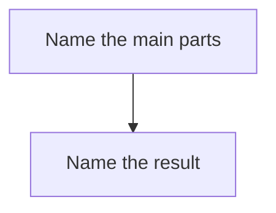

# Decision: <idea>

## Handoff

- Goal:
- Status: proposed
- Owner decision:
- Why:
- Merge order:

## Exec view

(summary of exec.md)

## Product view

(summary of product.md)

## Dev view

(summary of dev.md)

## Marketing view

(filled after the feature is proven)

## Lessons

Coding chats append here: what broke, what later tasks must know, and the fix. Do not wait for the owner.
