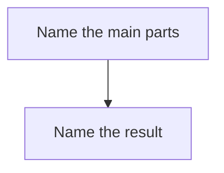

# Dev: <idea>

Status: planning

## Architecture

## Task and PR merge order

1.

## Notes

Each task is one PR. List `edits` (write) and `uses` (read) in `tasks.json` before any coding chat starts. Children may open on the parent branch and keep working; they merge only after the parent is proven, then rebase and fix clashes themselves.
